> **Disciplina:** Sistemas Operacionais  
> **Tema:** Malware: Análise, Detecção, Prevenção e Resposta a Incidentes  
> **Professor:** José Carlos Flores  
> **Curso:** Engenharia de Software  
> 
---


# Malware: Análise, Detecção, Prevenção e Resposta a Incidentes


## 1. Introdução a Malware e Tipos de Malware  

### O que é Malware?  

* **Malware** (*Malicious Software* / Software Malicioso) é qualquer programa projetado para danificar, explorar ou obter acesso não autorizado a um sistema de computação, rede ou dados.

* Pode corromper arquivos, roubar informações, interromper operações ou conceder aos atacantes o controle sobre um sistema.

### Pontos-Chave  

* Malware é criado intencionalmente.

* Pode se propagar por arquivos, e-mails, websites ou redes.

* Pode rodar em segundo plano sem o conhecimento do usuário.

* Pode roubar dados, corromper arquivos ou conceder acesso remoto a atacantes.

* Malware pode ter como alvo indivíduos, organizações e governos.

### Como o Malware Funciona? 

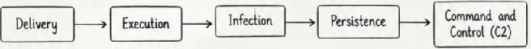

```
[Entrega (Delivery)]
O malware alcança o sistema alvo (por e-mail, download, website, etc.).
        ↓
[Execução (Execution)]
Ele é executado no sistema (geralmente sem a permissão do usuário).
        ↓
[Infecção (Infection)]
Executa atividades maliciosas (ex.: roubar dados, danificar arquivos).
        ↓
[Persistência (Persistence)]
Permanece no sistema para continuar suas atividades (ex.: inicialização, registro).
        ↓
[Comando e Controle (C2 / Command and Control)]
Pode se conectar ao servidor do atacante para receber instruções adicionais.

```


### Tipos de Malware (Types of Malware)

| Tipo | Descrição | Objetivo Principal | Exemplo |
| :--- | :--- | :--- | :--- |
| **Vírus (Virus)** | Anexa-se a um arquivo hospedeiro e se propaga quando o arquivo é executado. | Replicar e se espalhar | Vírus infector de arquivos (*File infector virus*) |
| **Worm** | Autorreplica-se e se espalha automaticamente por redes sem a necessidade de ação do usuário. | Espalhar-se por múltiplos sistemas | Conficker |
| **Cavalo de Troia (Trojan Horse)** | Parece um programa legítimo, mas executa atividades maliciosas. | Obter acesso não autorizado | Cavalo de Troia de Acesso Remoto (*RAT*) |
| **Ransomware** | Criptografa arquivos e exige um resgate para a descriptografia. | Extorquir dinheiro | WannaCry |
| **Spyware** | Coleta secretamente informações do usuário sem o seu consentimento. | Roubar dados confidenciais | Keyloggers |
| **Adware** | Exibe anúncios indesejados, frequentemente incluído junto com softwares gratuitos. | Gerar receita para os invasores | Sequestradores de navegador (*Browser hijackers*) |
| **Rootkit** | Oculta sua presença e concede acesso de alto nível aos invasores. | Manter acesso oculto | TDSS, ZeroAccess |
| **Bot** | Infecta um sistema e o transforma em um robô controlado pelo invasor. | Executar ataques automatizados (ex.: DDoS, spam) | Malware de botnet |
| **Keylogger** | Registra as teclas digitadas para roubar informações confidenciais. | Capturar credenciais de usuários | Keylogger de hardware ou software |
| **Malware Sem Arquivo (Fileless Malware)** | É executado diretamente na memória sem criar arquivos no disco. | Evitar detecção | Malware baseado em PowerShell |
## 2. Vírus  

### O que é um Vírus? 

* Um vírus é um tipo de malware que se anexa a um programa ou arquivo legítimo e se propaga quando o arquivo infectado é executado.

* Necessita de um arquivo hospedeiro (*host file*) para se replicar.

* Pode danificar arquivos, corromper dados ou interromper as operações do sistema.

### Características principais

* Anexa-se a um arquivo hospedeiro.

* Executa quando o arquivo hospedeiro roda.

* Pode se replicar e se propagar para outros arquivos.

* Pode carregar uma carga útil (*payload* / atividade maliciosa).

* Geralmente requer ação do usuário para se propagar.

* Pode infectar arquivos executáveis (`.exe`, `.com`, etc.).

### Como um Vírus Funciona 

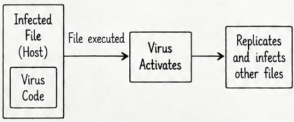

```
[Arquivo Infectado (Hospedeiro)] + [Código do Vírus]
                         ↓
                 [Arquivo executado]
                         ↓
                 [Vírus se Ativa]
                         ↓
         [Replica e infecta outros arquivos]

```

### Tipos de Vírus 

1. **File Infector Virus (Vírus Infector de Arquivos):** Infecta arquivos executáveis.

2. **Boot Sector Virus (Vírus de Setor de Inicialização):** Infecta o setor de boot do disco.

3. **Macro Virus (Vírus de Macro):** Infecta documentos (ex.: MS Word).

4. **Multipartite Virus (Vírus Multipartite):** Infecta tanto arquivos quanto o setor de boot.

5. **Polymorphic Virus (Vírus Polimórfico):** Modifica seu código para evitar a detecção.

6. **Metamorphic Virus (Vírus Metamórfico):** Reescreve completamente seu código.

7. **Stealth Virus (Vírus Furtivo):** Oculta sua presença dos mecanismos de detecção.

### Ciclo de Vida do Vírus

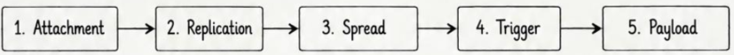


1. **Anexação (Attachment):** O vírus se anexa a um arquivo hospedeiro ou setor de boot.

2. **Replicação (Replication):** Cria cópias de si mesmo quando o arquivo hospedeiro é executado.

3. **Propagação (Spread):** Infecta outros arquivos ou sistemas por meio de ações do usuário (ex.: compartilhamento, e-mail, USB).

4. **Disparo (Trigger):** Ativado quando o arquivo infectado é executado. Pode possuir um gatilho específico.

5. **Carga Destrutiva (Payload):** Executa a atividade maliciosa, como excluir arquivos, corromper dados ou exibir mensagens.

### Exemplo

* Um vírus pode se anexar a um programa (ex.: `game.exe`).

* Quando o usuário executa o jogo, o vírus também executa.

* Em seguida, ele se copia para outros arquivos executáveis do sistema.

* Por fim, pode executar um payload, como excluir arquivos ou exibir uma mensagem.

### Prevenção 

* Usar software antivírus atualizado.

* Evitar a execução de arquivos desconhecidos ou suspeitos.

* Não abrir anexos de e-mail de fontes desconhecidas.

* Desativar a reprodução automática (*autorun*) para dispositivos externos.

* Manter o sistema operacional e os softwares atualizados.

* Utilizar firewall e práticas de navegação segura.

## 3. Worms 

### O que é um Worm? 

* Um worm é um tipo de malware que consegue se autorreplicar e se propagar automaticamente por uma rede sem qualquer ação do usuário.

* Não precisa se anexar a um arquivo hospedeiro como um vírus.

* Pode se propagar de um computador para outro explorando vulnerabilidades de segurança.

* Pode consumir recursos do sistema, degradar o desempenho de redes e entregar cargas úteis (*payloads*), como backdoors ou ransomware.

### Características Principais

* Autorreplica-se automaticamente.

* Propaga-se através de redes.

* Não requer intervenção do usuário.

* Explora vulnerabilidades em sistemas ou serviços.

* Pode se propagar em velocidade muito alta.

* Pode consumir largura de banda da rede e recursos do sistema.

* Pode carregar payloads maliciosos adicionais.

### Como um Worm Funciona? 
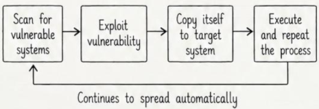


```
[Escanear em busca de sistemas vulneráveis]
                     ↓
         [Explorar vulnerabilidade]
                     ↓
       [Copiar-se para o sistema alvo]
                     ↓
             [Executar código]
                     ↓
           (Repete o processo)
                     ↓
     [Continua a se propagar automaticamente]

```

### Processo de Autorreplicação 

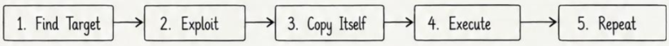  

1. **Localizar o Alvo (Find Target):** Escaneia a rede para encontrar sistemas vulneráveis (usando faixas de IP ou escaneamento aleatório).

2. **Explorar (Exploit):** Usa uma vulnerabilidade conhecida para obter acesso ao sistema alvo.

3. **Copiar-se (Copy Itself):** Cria uma cópia do seu código no sistema alvo.

4. **Executar (Execute):** Executa o código copiado no sistema alvo (normalmente como um novo processo ou serviço).

5. **Repetir (Repeat):** O novo sistema infectado também começa a escanear e se propagar para outros sistemas.

### Exemplos de Worms 

1. **Morris Worm:** Propagou-se pela internet (1988).

2. **Code Red:** Explorou vulnerabilidade no IIS (2001).

3. **Slammer:** Propagou-se rapidamente usando um *buffer overflow* (2003).

4. **Conficker:** Infectou sistemas Windows (2008).

5. **Stuxnet:** Teve como alvo sistemas de controle industrial (2010).

### Tabela Comparativa: Worm vs Vírus 


| Característica | Worm | Vírus |
| :--- | :---: | :---: |
| **Precisa de arquivo hospedeiro** | Não | Sim |
| **Intervenção do usuário** | Não | Geralmente sim |
| **Propaga-se pela rede** | Sim | Na maioria das vezes não |
| **Autorreplicação** | Sim | Sim |
| **Velocidade de propagação** | Muito rápida | Mais lenta |
| **Exemplo** | Morris, Conficker | Vírus infector de arquivos (*File infector virus*) |

### Prevenção

* Manter o sistema operacional e softwares atualizados.

* Aplicar patches em vulnerabilidades conhecidas.

* Usar firewall e medidas de segurança de rede.

* Monitorar atividades incomuns de rede.

* Utilizar ferramentas antivírus e antimalware.

* Desativar serviços desnecessários e portas abertas.

* Implementar sistemas de detecção e prevenção de intrusão (IDS/IPS).

## 4. Trojan 

### O que é um Trojan? 

* Um Trojan (*Trojan Horse* / Cavalo de Troia) é um tipo de malware que aparenta ser um programa legítimo ou útil, mas executa atividades maliciosas.

* Não se autorreplica como um vírus ou worm.

* Geralmente requer ação do usuário para ser executado (ex.: download e execução).

* Pode conceder acesso não autorizado, roubar dados ou danificar o sistema.

### Características Principais

* Disfarçado como um arquivo ou software legítimo.

* Não se autorreplica.

* Requer ação do usuário para ser instalado ou executado.

* Pode realizar diversas atividades maliciosas.

* Frequentemente usado para fornecer acesso não autorizado.

* Pode evadir a detecção parecendo um programa normal.

### Como um Trojan Funciona? 
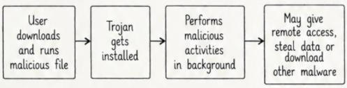


```
[Usuário baixa e executa arquivo malicioso]
                     ↓
        [O Trojan é instalado]
                     ↓
[Executa atividades maliciosas em segundo plano]
                     ↓
[Pode conceder acesso remoto, roubar dados ou baixar outros malwares]

```

### Tipos comuns de Trojans

1. **Remote Access Trojan (RAT):** Concede controle remoto ao atacante.

2. **Banking Trojan (Trojan Bancário):** Rouba informações financeiras.

3. **Downloader Trojan:** Baixa e instala outros malwares.

4. **Spy Trojan:** Rouba dados sensíveis.

5. **Destructive Trojan (Trojan Destrutivo):** Danifica ou apaga arquivos.

6. **Backdoor Trojan:** Cria uma porta oculta para acessos futuros.

### Trojan de Acesso Remoto (RAT - Remote Access Trojan)

* Um **Remote Access Trojan (RAT)** é um tipo de Trojan que permite a um atacante obter controle remoto total sobre o sistema infectado.

* Concede ao atacante acesso irrestrito ao computador da vítima.

* RATs podem ser usados para roubar dados, monitorar atividades, instalar mais malware ou controlar o sistema.

* Frequentemente utilizado em ataques direcionados e ciberespionagem.


### Características de um RAT 

* Fornece acesso e controle remoto.

* Permite upload e download de arquivos.

* Consegue capturar teclas digitadas (*keystrokes*) e tela (*screenshots*).

* Pode ativar webcam e microfone.

* Consegue executar comandos no sistema.

* Frequentemente roda em segundo plano.

* Pode manter persistência para acesso a longo prazo.

### Como um RAT Funciona?  
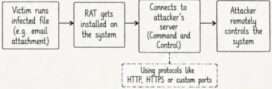
```
[Vítima executa arquivo infectado (ex.: anexo de e-mail)]
                     ↓
       [RAT é instalado no sistema]
                     ↓
[Conecta-se ao servidor do atacante (Command and Control)]
  (Usando protocolos como HTTP, HTTPS ou portas customizadas)
                     ↓
   [Atacante controla remotamente o sistema]

```


### Exemplos de RATs 

* DarkComet

* njRAT

* Quasar RAT

* AsyncRAT

* NetWire

* Remcos RAT

### Prevenção 

* Não executar arquivos de fontes desconhecidas.

* Ter cautela com anexos de e-mail.

* Usar ferramentas antivírus e antimalware atualizadas.

* Manter o sistema operacional e softwares atualizados.

* Usar firewall e medidas de segurança de rede.

* Evitar o download de softwares piratas ou com *cracks*.

* Monitorar o sistema em busca de atividades incomuns.

## 5. Ransomware 

### O que é Ransomware? 
* Ransomware é um tipo de malware que criptografa arquivos ou bloqueia o sistema e exige um resgate (*ransom*, quantia em dinheiro) para restabelecer o acesso.

* Pode ter como alvo usuários domésticos, organizações ou infraestruturas críticas.

* Geralmente se propaga por e-mails maliciosos, downloads ou vulnerabilidades de rede.

### Características principais 

* Criptografa arquivos ou bloqueia o sistema.

* Exige um resgate para fornecer a chave de decifração.

* Pode se propagar dentro de uma rede.

* Pode excluir ou vazar dados caso o resgate não seja pago.

* Almeja indivíduos, empresas e governos.

* Frequentemente utiliza criptografia forte (ex.: AES, RSA), tornando extremamente difícil recuperar arquivos sem a chave.

### Como o Ransomware Funciona? 
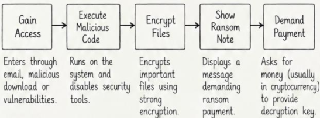

```
[Obter Acesso (Gain Access)]
Entra por e-mail, download malicioso ou vulnerabilidades.
                     ↓
[Executar Código Malicioso (Execute Malicious Code)]
Executa no sistema e desativa ferramentas de segurança.
                     ↓
[Criptografar Arquivos (Encrypt Files)]
Criptografa arquivos importantes usando criptografia forte.
                     ↓
[Exibir Nota de Resgate (Show Ransom Note)]
Exibe uma mensagem exigindo o pagamento do resgate.
                     ↓
[Exigir Pagamento (Demand Payment)]
Pede dinheiro (geralmente em criptomoeda) para fornecer a chave de decifração.

```

### Tipos Comuns de Ransomware 

1. **Crypto Ransomware:** Criptografa arquivos.

2. **Locker Ransomware:** Bloqueia o acesso ao sistema.

3. **Doxware:** Criptografa arquivos e ameaça vazar dados confidenciais.

4. **Ransomware as a Service (RaaS):** Fornecido a outros atacantes como serviço.

5. **Double Extortion (Dupla Extorsão):** Criptografa arquivos e também rouba dados para vazamento.

6. **Scareware:** Falso ransomware usado para enganar e assustar usuários.

### Ciclo de Vida do Ransomware 
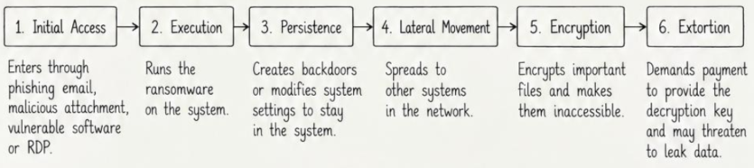

1. **Acesso Inicial (Initial Access):** Entra por meio de e-mail de phishing, anexo malicioso, software vulnerável ou RDP.

2. **Execução (Execution):** Executa o ransomware no sistema.

3. **Persistência (Persistence):** Cria backdoors ou modifica configurações do sistema para permanecer ativo.

4. **Movimentação Lateral (Lateral Movement):** Propaga-se para outros sistemas dentro da rede.

5. **Criptografia (Encryption):** Criptografa arquivos essenciais e os torna inacessíveis.

6. **Extorsão (Extortion):** Exige pagamento para fornecer a chave de decifração e pode ameaçar vazar os dados.

### Exemplos de Ransomware 

* WannaCry

* Ryuk

* Conti

* REvil (Sodinokibi)

* LockBit

* DarkSide

* BlackCat (ALPHV)

### Prevenção e Proteção 

* Não abrir e-mails ou anexos suspeitos.

* Manter o sistema operacional e softwares atualizados.

* Usar ferramentas robustas de antivírus e antimalware.

* Habilitar firewall e medidas de segurança de rede.

* Fazer backup regular de dados críticos (backup offline).

* Usar autenticação multifator (MFA).

* Restringir o acesso a sistemas sensíveis.

## 6. Spyware e Keyloggers

### O que é Spyware? 

* Spyware é um tipo de malware que coleta secretamente informações do dispositivo do usuário sem o seu conhecimento ou consentimento.

* Monitora as atividades do usuário e envia os dados coletados a um atacante.

* Pode ser instalado por meio de sites maliciosos, anexos de e-mail ou embutido em softwares gratuitos.

### Características principais do Spyware 

* Executa silenciosamente em segundo plano.

* Coleta informações sensíveis.

* Pode rastrear histórico de navegação, senhas, arquivos e atividades do sistema.

* Pode alterar configurações do sistema.

* Frequentemente se comunica com um servidor remoto.

* Pode ser usado para ataques direcionados ou roubo de identidade.

### Como o Spyware Funciona? 
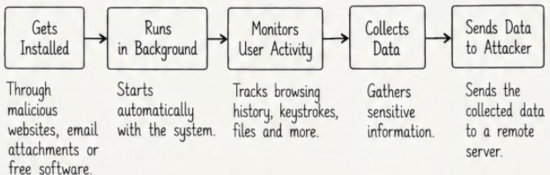

```
[É Instalado (Gets Installed)]
Por meio de sites maliciosos, anexos de e-mail ou softwares gratuitos.
                     ↓
[Executa em Segundo Plano (Runs in Background)]
Inicia automaticamente com o sistema.
                     ↓
[Monitora Atividade do Usuário (Monitors User Activity)]
Rastreia histórico de navegação, teclas digitadas, arquivos e mais.
                     ↓
[Coleta Dados (Collects Data)]
Reúne informações sensíveis.
                     ↓
[Envia Dados ao Atacante (Sends Data to Attacker)]
Envia os dados coletados a um servidor remoto.

```

### Tipos de Spyware (Types of Spyware)

1. **Adware:** Exibe anúncios indesejados e rastreia o comportamento do usuário.

2. **Browser Hijacker:** Altera configurações do navegador e redireciona para sites indesejados.

3. **Tracking Cookie (Cookie de Rastreamento):** Monitora a atividade de navegação.

4. **System Monitor (Monitor de Sistema):** Rastreia o uso geral do sistema.

5. **Credential Stealer (Ladrão de Credenciais):** Coleta nomes de usuário, senhas e outros dados sensíveis.

6. **Remote Access Spyware:** Concede acesso remoto ao atacante.

### O que são Keyloggers? 

* Um keylogger é um tipo de spyware que registra cada tecla pressionada pelo usuário.

* Pode capturar credenciais, senhas, dados de cartão de crédito, mensagens e outras informações confidenciais.

* Keyloggers podem ser baseados em hardware ou software.

* Geralmente rodam em segundo plano e enviam os dados capturados ao atacante.

### Características principais dos Keyloggers 

* Registra todas as entradas de teclado.

* Pode capturar senhas, mensagens e outros dados.

* Executa silenciosamente em segundo plano.

* Pode ser instalado por software malicioso ou dispositivo de hardware.

* Frequentemente utilizado para roubo de identidade e obtenção de acesso não autorizado.

### Como um Keylogger Funciona? 
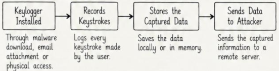

```
[Keylogger Instalado] 
(Download de malware, anexo de e-mail ou acesso físico)
                     ↓
[Registra as Teclas Pressionadas (Records Keystrokes)]
(Registra cada tecla pressionada pelo usuário)
                     ↓
[Armazena os Dados Capturados (Stores the Captured Data)]
(Salva os dados localmente ou em memória)
                     ↓
[Envia Dados ao Atacante (Sends Data to Attacker)]
(Envia as informações capturadas para um servidor remoto)

```

### Tipos de Keyloggers 

1. **Software Keylogger:** Instalado como um programa malicioso.

2. **Hardware Keylogger:** Dispositivo físico conectado ao teclado.

3. **Wireless Keylogger:** Captura as teclas por meio de conexões sem fio.

4. **Form Grabbing Keylogger:** Captura dados inseridos diretamente em formulários web.

### Exemplos 

* **Exemplos de Spyware:** CoolWebSearch, Gator, FinFisher, PCSpy, módulos de Adware.

* **Exemplos de Keyloggers:** Ardamax Keylogger, Revealer Keylogger, Refog Keylogger, Spyrix Keylogger, Zemana Keylogger.

### Prevenção e Proteção 

* Usar software antivírus e antimalware atualizado.

* Evitar o download de softwares de fontes desconhecidas.

* Não clicar em links ou anexos suspeitos.

* Usar senhas fortes e exclusivas.

* Habilitar firewall e configurações de segurança do sistema.

* Verificar regularmente por programas ou processos desconhecidos.

## 7. Adware e Browser Hijackers

### O que é Adware?

* Adware é um tipo de malware que exibe propagandas indesejadas no dispositivo do usuário.

* Costuma vir embutido em softwares gratuitos e é instalado sem o conhecimento ou consentimento explícito do usuário.

* Normalmente não danifica arquivos, mas pode rastrear a atividade do usuário e coletar dados para fins de publicidade.

* Pode deixar o sistema lento e degradar a experiência de navegação.

### Características principais do Adware 

* Exibe anúncios indesejados, pop-ups e banners.

* Frequentemente embutido em softwares gratuitos ou piratas.

* Pode rastrear hábitos de navegação e coletar dados do usuário.

* Pode alterar configurações do navegador.

* Geralmente não se autorreplica.

* Pode reduzir o desempenho do sistema.

* Pode redirecionar para websites maliciosos.

### Como o Adware Funciona? 
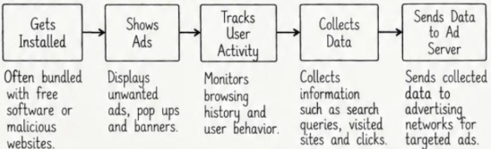

```
[É Instalado (Gets Installed)]
Frequentemente embutido em software gratuito ou sites maliciosos.
                     ↓
[Exibe Anúncios (Shows Ads)]
Apresenta anúncios indesejados, pop-ups e banners.
                     ↓
[Rastreia Atividade do Usuário (Tracks User Activity)]
Monitora histórico de navegação e comportamento.
                     ↓
[Coleta Dados (Collects Data)]
Coleta buscas, sites visitados e cliques.
                     ↓
[Envia Dados ao Servidor de Anúncios (Sends Data to Ad Server)]
Envia os dados coletados a redes de publicidade para anúncios direcionados.

```

### O que são Browser Hijackers? 

* *Browser Hijackers* (sequestradores de navegador) são tipos de malware que alteram as configurações do navegador sem o consentimento do usuário.

* Modificam a página inicial (*homepage*), mecanismo de busca padrão e a página de nova guia.

* Podem redirecionar os usuários para sites indesejados ou maliciosos.

* Costumam vir empacotados com softwares gratuitos, anexos de e-mail ou sites maliciosos.

### Características principais dos Browser Hijackers 

* Modificam página inicial, mecanismo de busca e nova aba do navegador.

* Redirecionam para websites indesejados ou maliciosos.

* Podem exibir anúncios indesejados.

* Frequentemente embutidos em softwares gratuitos.

* Podem rastrear a atividade de navegação.

* Normalmente não danificam arquivos, mas afetam a navegação.

* Podem ser difíceis de remover.

### Como os Browser Hijackers Funcionam? 
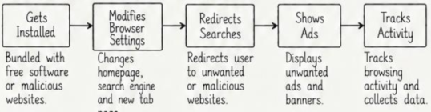

```
[É Instalado] → Embutido com software gratuito ou sites maliciosos.
       ↓
[Modifica Configurações do Navegador] → Altera página inicial, mecanismo de busca e nova guia.
       ↓
[Redireciona Buscas] → Redireciona o usuário para sites indesejados ou maliciosos.
       ↓
[Exibe Anúncios] → Exibe propagandas e banners indesejados.
       ↓
[Rastreia Atividade] → Monitora a atividade de navegação e coleta dados.

```

### Tabela Comparativa: Adware vs Browser Hijackers


| Característica | Adware | Sequestradores de Navegador (*Browser Hijackers*) |
| --- | --- | --- |
| **Objetivo Principal** | Exibir anúncios indesejados | Alterar as configurações do navegador |
| **Afeta as Configurações do Navegador** | Pode alterar configurações | Sempre altera configurações |
| **Rastreia a Atividade do Usuário** | Sim | Sim |
| **Redireciona para Outros Sites** | Às vezes | Sim |
| **Instala-se com Software Gratuito** | Sim | Sim |
| **Impacto Principal** | Anúncios indesejados, lentidão no sistema | Altera a página inicial e o mecanismo de busca |

### Exemplos 

* **Exemplos de Adware:** Fireball, Conduit, SmartBar, RelevantKnowledge, GoSave, Adware.Generic, OpenCandy, SavePass.

* **Exemplos de Browser Hijackers:** CoolWebSearch, Ask Toolbar, Babylon, Delta Search, MyWebSearch, Web Searches, Search-Results Toolbar, SweetPage.

### Prevenção e Proteção

* Baixar software apenas de fontes confiáveis.

* Evitar instalar softwares desconhecidos ou oferecidos em pacotes (*bundled*).

* Usar ferramentas antivírus e antimalware atualizadas.

* Verificar e restaurar configurações do navegador regularmente.

* Não clicar em anúncios suspeitos ou pop-ups.

* Usar extensões de navegador para bloquear anúncios indesejados.

* Manter o sistema operacional e os navegadores atualizados.

* Ter cautela com anexos de e-mail e links desconhecidos.

## 8. Rootkits + Bootkits

### O que é um Rootkit?

* Um rootkit é um tipo de malware projetado para obter e manter acesso não autorizado a um sistema enquanto oculta sua presença.

* Oculta arquivos, processos, conexões de rede e outras atividades maliciosas.

* É comumente utilizado por atacantes para manter acesso persistente e privilegiado (frequentemente em nível de administrador/root) a um sistema comprometido.

* Pode se apresentar sob diferentes formas, como baseado em software ou hardware.

### Características Principais dos Rootkits  

* Oculta sua presença do usuário e de ferramentas de segurança.

* Modifica arquivos de sistema, processos e configurações.

* Fornece acesso privilegiado ao sistema (frequentemente nível administrador).

* Pode interceptar e manipular chamadas de sistema (*system calls*).

* Consegue desativar ou contornar ferramentas de segurança como antivírus.

* Mantém persistência mesmo após a reinicialização do sistema.

* Frequentemente empregado em ataques direcionados e ameaças persistentes avançadas (APT).

### Como um Rootkit Funciona? 
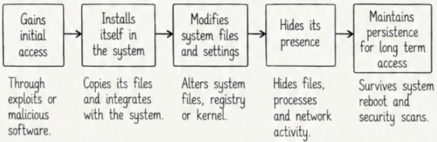

```
[Obtém Acesso Inicial] 
Por meio de exploits ou software malicioso.
         ↓
[Instala-se no Sistema] 
Copia seus arquivos e se integra com o sistema operacional.
         ↓
[Modifica Arquivos e Configurações de Sistema] 
Altera arquivos de sistema, registro ou kernel.
         ↓
[Oculta sua Presença] 
Oculta arquivos, processos e atividades de rede contra escaneamentos de segurança.
         ↓
[Mantém Persistência para Acesso de Longo Prazo] 
Sobrevive à reinicialização do sistema e inspeções de segurança.

```

### Tipos de Rootkits 

1. **User Mode Rootkit (Modo Usuário):** Executa no espaço do usuário (*user space*) e oculta arquivos e processos.

2. **Kernel Mode Rootkit (Modo Kernel):** Executa no espaço do kernel (*kernel space*) e possui privilégios mais elevados.

3. **Application Rootkit (Modo Aplicação):** Modifica aplicações legítimas.

4. **Library Rootkit (Biblioteca):** Infecta bibliotecas do sistema.

5. **Firmware Rootkit:** Armazenado no firmware do dispositivo (ex.: BIOS, UEFI).

### O que é um Bootkit? 

* Um bootkit é um tipo avançado de rootkit que infecta o setor de boot ou o processo de inicialização de um sistema.

* Executa antes do carregamento do sistema operacional e consegue assumir o controle em um estágio muito inicial.

* Bootkits são altamente perigosos porque podem sobreviver à reinstalação do sistema operacional e são difíceis de detectar.

* Frequentemente têm como alvo o Master Boot Record (MBR) ou o firmware UEFI.

### Características Principais dos Bootkits  

* Infecta o setor de boot ou o bootloader.

* Roda antes de o sistema operacional ser carregado.

* Pode modificar o processo de inicialização.

* Mantém a persistência mesmo após a formatação e reinstalação do SO.

* Difícil de detectar e remover.

* Frequentemente mira o MBR ou o firmware UEFI.

* Fornece controle e acesso em nível muito baixo ao sistema.

### Como um Bootkit Funciona? 
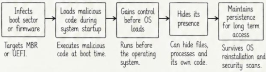

```
[Infecta Setor de Boot ou Firmware] 
Tem como alvo MBR ou UEFI.
         ↓
[Carrega Código Malicioso Durante Inicialização] 
Executa código malicioso no momento do boot.
         ↓
[Ganha Controle Antes do Carregamento do SO] 
Roda antes de o sistema operacional iniciar.
         ↓
[Oculta sua Presença] 
Consegue esconder arquivos, processos e seu próprio código.
         ↓
[Mantém Persistência de Longo Prazo] 
Sobrevive à reinstalação do SO e varreduras de segurança.

```

### Tipos de Bootkits 

1. **MBR Bootkit:** Infecta o Master Boot Record de um disco rígido.

2. **UEFI Bootkit:** Infecta o firmware UEFI.

3. **Bootloader Bootkit:** Modifica o carregador de inicialização (ex.: GRUB).

4. **Firmware Bootkit:** Gravado no firmware do hardware, persistindo por longos períodos.

### Tabela Comparativa: Rootkit vs Bootkit


| Característica | Rootkit | Bootkit |
| ----- | ----- | ----- |
| **Alvo (*Target*)** | Arquivos do SO, processos, configurações do sistema | Setor de inicialização (*boot sector*) ou processo de boot |
| **Momento de Execução** | Após o carregamento do SO | Antes do carregamento do SO |
| **Persistência** | Alta (varia conforme o tipo) | Muito alta (resiste à reinstalação do SO) |
| **Detecção** | Difícil, mas possível | Mais difícil de detectar |
| **Exemplos** | Modo de usuário (*User mode*), modo de kernel (*Kernel mode*) | Bootkit MBR, Bootkit UEFI | 

### Prevenção e Proteção 

* Manter o sistema operacional e o firmware atualizados.

* Utilizar inicialização segura (UEFI Secure Boot).

* Usar ferramentas de antivírus e antimalware confiáveis.

* Verificar regularmente alterações suspeitas no sistema.

* Monitorar processos de inicialização do sistema.

* Usar criptografia de disco.

* Evitar instalar softwares desconhecidos ou não confiáveis.

* Empregar recursos de segurança baseados em hardware (TPM).

## 9. Botnets e Comando e Controle (Command and Control)

### O que é uma Botnet? 

* Uma botnet é uma rede de computadores ou dispositivos infectados que são controlados remotamente por um atacante.

* Esses dispositivos infectados são chamados de **bots** ou **zumbis** (*zombies*).

* Podem incluir computadores, dispositivos móveis, dispositivos de Internet das Coisas (IoT) e servidores.

* O atacante usa a botnet para realizar atividades maliciosas sem o conhecimento dos proprietários dos dispositivos.

* Podem ser massivas, contendo milhares ou milhões de dispositivos infectados.

### Características principais das Botnets 

* Composta por muitos dispositivos infectados (bots).

* Controlada por um atacante central (*botmaster*).

* Frequentemente disseminada por meio de malware.

* Capaz de executar atividades maliciosas simultaneamente a partir de vários dispositivos.

* Difícil de detectar e desmantelar.

* Abrange múltiplos tipos de equipamentos (PCs, servidores, smartphones, IoT).

* Usada para ataques DDoS, spam, mineração de criptomoedas, etc.

* Comunica-se com um servidor de Comando e Controle (C2) para obter instruções.

### Usos Comuns de Botnets 

1. **DDoS Attacks (Ataques DDoS):** Sobrecarga de servidores com tráfego massivo.

2. **Spamming:** Disparo em massa de e-mails de spam.

3. **Malware Distribution (Distribuição de Malware):** Disseminação de outros tipos de malware.

4. **Cryptocurrency Mining (Mineração de Criptomoeda):** Uso de dispositivos infectados para minerar criptoativos.

5. **Data Theft (Roubo de Dados):** Roubo de informações confidenciais.

6. **Click Fraud (Fraude de Cliques):** Geração de cliques falsos em anúncios online.

7. **Proxy Network (Rede de Proxies):** Ocultação da identidade real do atacante.

### Como uma Botnet Funciona? 
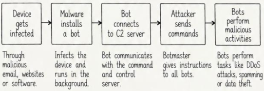
```
[Dispositivo é Infectado] 
(Por e-mail, websites ou softwares maliciosos)
           ↓
[Malware Instala um Bot] 
(Infecta o dispositivo e executa em segundo plano)
           ↓
[Bot Conecta-se ao Servidor C2] 
(Comunica-se com o servidor de comando e controle)
           ↓
[Atacante Envia Comandos] 
(Botmaster dá instruções a todos os bots)
           ↓
[Bots Executam Atividades Maliciosas] 
(Executam ataques DDoS, spam ou roubo de dados)

```

### O que é Comando e Controle (C2)? 

* Um servidor ou infraestrutura de **Comando e Controle (C2 / C&C)** é o canal usado pelo atacante para se comunicar com os dispositivos infectados (bots).

* O atacante envia comandos para os bots por meio do C2.

* Os bots recebem os comandos e enviam de volta dados coletados ou status de execução.

* A comunicação com o C2 pode utilizar protocolos como HTTP, HTTPS, DNS, IRC ou protocolos customizados.

### Características principais do C2 

* Atua como o canal de comunicação entre atacante e bots.

* Envia comandos aos dispositivos infectados.

* Recebe dados roubados e relatórios de status dos bots.

* Emprega múltiplos métodos (HTTP, DNS, IRC, P2P).

* Frequentemente mascara o atacante real usando proxies, redes Tor ou criptografia.

* Pode ser centralizado (servidor único) ou descentralizado (peer-to-peer).

* Difícil de detectar porque o tráfego muitas vezes se assemelha à navegação de rede comum.

### Tipos de comunicação C2 

| Tipo | Descrição | Exemplo |
| --- | --- | --- |
| **HTTP/HTTPS** | Usa tráfego web para se comunicar com o servidor C2 | Requisições para um site malicioso |
| **DNS** | Usa consultas DNS para enviar e receber comandos | Comandos codificados em requisições DNS |
| **IRC** | Usa *Internet Relay Chat* para comunicação | O bot entra em um canal de IRC |
| **P2P** | Os bots se comunicam diretamente entre si | Nenhum servidor central único |
| **Protocolo Personalizado (*Custom Protocol*)** | Usa protocolos projetados especificamente para ocultar o tráfego | Comunicação personalizada criptografada |


### Exemplos de Botnets (Examples of Botnets)

1. **Mirai:** Direcionada a dispositivos IoT, como roteadores e câmeras.

2. **Zeus:** Especializada em roubo de credenciais bancárias.

3. **Conficker:** Infectou milhões de sistemas Windows.

4. **GameOver Zeus:** Usada para roubo de dados bancários e distribuição de spam.

5. **Emotet:** Utilizada amplamente como distribuidor de outros malwares (*loader*).

6. **Necurs:** Uma das maiores botnets para envio em massa de spam.

7. **Smokeloader:** Usada para baixar e executar múltiplos tipos de ameaças.

### Prevenção e Proteção 

* Manter o sistema operacional e softwares atualizados.

* Usar ferramentas robustas de antivírus e antimalware.

* Evitar clicar em links e anexos suspeitos.

* Monitorar o tráfego de rede para detectar comportamentos anômalos.

* Bloquear domínios e endereços IP maliciosos conhecidos.

* Implementar firewalls e sistemas de detecção de intrusão (IDS).

* Desativar serviços desnecessários e fechar portas não utilizadas.

## 10. Fileless Malware e Living off the Land 

### O que é Fileless Malware? 

* *Fileless malware* (malware sem arquivos) é um tipo de ameaça que opera diretamente na memória (RAM) sem descarregar arquivos maliciosos tradicionais no disco.

* Utiliza ferramentas, utilitários e processos legítimos do próprio sistema para executar código malicioso.

* Apresenta alta dificuldade de detecção por não deixar arquivos ou assinaturas convencionais no armazenamento em disco.

* É frequentemente empregado em ataques direcionados e campanhas de Ameaça Persistente Avançada (APT).

### Características principais do Fileless Malware 

* Executa na memória (RAM).

* Não cria arquivos binários em disco.

* Utiliza utilitários e processos legítimos do sistema operacional.

* Consegue contornar a detecção de antivírus tradicionais baseados em assinatura.

* Geralmente entregue por meio de e-mails de phishing, documentos com macros ou exploração de vulnerabilidades.

* Utilizado para roubo de credenciais, exfiltração de dados e acesso remoto.

* Deixa vestígios forenses mínimos no disco.

### Como o Fileless Malware Funciona?  
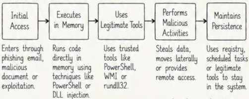
```
[Acesso Inicial (Initial Access)]
Entra por phishing, documento com macro ou exploit.
                  ↓
[Executa na Memória (Executes in Memory)]
Executa código diretamente na RAM usando PowerShell, injeção de DLL, etc.
                  ↓
[Utiliza Ferramentas Legítimas (Uses Legitimate Tools)]
Usa utilitários confiáveis como PowerShell, WMI ou rundll32.
                  ↓
[Executa Atividades Maliciosas (Performs Malicious Activities)]
Rouba dados, move-se lateralmente ou provê acesso remoto.
                  ↓
[Mantém Persistência (Maintains Persistence)]
Usa o registro do sistema, tarefas agendadas ou ferramentas legítimas para persistir.

```

### O que é Living off the Land (LotL)?

* **Living off the Land (LotL)** é uma técnica em que os atacantes utilizam binários, utilitários e ferramentas administrativas legítimas pré-instaladas no sistema operacional para conduzir atividades maliciosas.

* Elimina a necessidade de instalar novos malwares no alvo, permitindo camuflar as ações maliciosas em meio à atividade rotineira do sistema.

* Frequentemente referidos como **LOLBins** (*Living off the Land Binaries*).

### Características Principais de Living off the Land

* Utiliza ferramentas legítimas e assinadas digitalmente.

* Não requer a instalação de novos arquivos binários.

* Mistura-se perfeitamente com os logs de administração legítima.

* Difícil detecção por soluções convencionais de antivírus.

* Usado para reconhecimento, movimentação lateral, persistência e exfiltração de dados.

### Ferramentas Comuns Usadas em LotL (Common Tools Used in LotL)

| Ferramenta (*Tool*) | Finalidade (*Purpose*) | 
| ----- | ----- | 
| **PowerShell** | Executar scripts, baixar arquivos e executar comandos | 
| **WMI** | Gerenciar e executar comandos em sistemas locais ou remotos | 
| **CMD** | Executar comandos e scripts do sistema | 
| **rundll32** | Executar arquivos DLL | 
| **regsvr32** | Carregar e executar código malicioso | 
| **mshta** | Executar aplicativos HTML (*HTML Applications*) | 
| **certutil** | Baixar arquivos de servidores remotos | 
| **bitsadmin** | Transferir arquivos em segundo plano | 
| **schtasks** | Criar tarefas agendadas para persistência | 
 

### Exemplos Comuns de Fileless Malware 

1. Ataques baseados em scripts de PowerShell.

2. Ataques baseados em WMI (*Windows Management Instrumentation*).

3. Execuções de código malicioso através de `rundll32`.

4. Macros maliciosas incorporadas em documentos do Microsoft Office.

5. Malwares executados exclusivamente em memória, como payloads do Meterpreter.

6. Injeção reflexiva de DLL (*Reflective DLL injection*).

7. Frameworks como Empire e Cobalt Strike (usados em campanhas adversárias e testes de Red Team).


### Exemplos de técnicas de Living off the Land

1. Usar `PowerShell` para baixar e executar código malicioso diretamente na RAM.

2. Usar `WMI` para acionar comandos em múltiplos computadores remotos da rede.

3. Usar `rundll32` ou `regsvr32` para carregar DLLs maliciosas remotas.

4. Usar `mshta` para interpretar scripts maliciosos inline hospedados em servidores web.

5. Usar `certutil` ou `bitsadmin` para contornar bloqueios e baixar arquivos maliciosos.

6. Usar `schtasks` para garantir persistência no sistema.

7. Usar LOLBins para extrair credenciais (*credential dumping*) e movimentação lateral.

### Prevenção e Proteção 

* Monitorar e auditar o uso de ferramentas de linha de comando e scripts do sistema.

* Empregar soluções de detecção comportamental e proteção de endpoints (EDR/XDR).

* Restringir o uso de ferramentas administrativas desnecessárias (ex.: PowerShell em modo restrito, bloqueio de CMD para usuários comuns).

* Aplicar o princípio do menor privilégio (*Least Privilege*).

* Monitorar anomalias no tráfego de rede causadas por binários legítimos.

* Implementar controle de execução e listas de permissão (*application whitelisting*).

* Manter o sistema operacional e ferramentas de segurança constantemente atualizados.

## 11. Métodos de Entrega de Malware 

### O que são Métodos de Entrega de Malware? 

* Métodos de entrega de malware representam os diferentes canais e técnicas que os atacantes usam para transportar e introduzir softwares maliciosos em um sistema-alvo.

* O objetivo é fazer com que o malware alcance o dispositivo e seja executado com sucesso.

* Abrangem desde phishing e exploração de vulnerabilidades até engenharia social e dispositivos removíveis.

* Após a entrega, o malware pode executar de forma imediata ou aguardar condições específicas para evadir detecção.

### Características principais 

* Utiliza múltiplos canais de comunicação para alcançar o alvo.

* Frequentemente fundamenta-se em engenharia social para manipular o usuário.

* Pode entregar malware em diferentes formatos (documentos, scripts, executáveis, links).

* Pode explorar vulnerabilidades em softwares desatualizados.

* Projetado para contornar filtros e defesas de segurança perimetral.

* Às vezes faz uso de serviços e plataformas legítimas na nuvem.

* Emprega criptografia, ofuscação ou técnicas fileless para evitar detecção.

* Pode ser disparado em campanhas massivas ou em operações cirúrgicas (direcionadas).

### Métodos comuns de entrega de Malware 
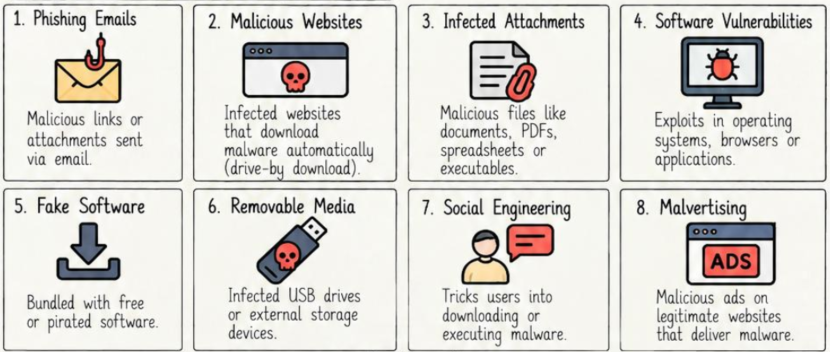


1. **Phishing Emails (E-mails de Phishing):** Links maliciosos ou anexos infectados enviados por e-mail.

2. **Malicious Websites (Websites Maliciosos):** Sites comprometidos que realizam downloads automáticos (*drive-by download*).

3. **Infected Attachments (Anexos Infectados):** Arquivos perigosos (PDF, DOCX, XLSX, ZIP) distribuídos em mensagens.

4. **Software Vulnerabilities (Vulnerabilidades de Software):** Falhas em sistemas operacionais, navegadores ou aplicações exploradas por atacantes.

5. **Fake Software (Softwares Falsos):** Malware camuflado ou empacotado com softwares gratuitos, ativadores e versões piratas.

6. **Removable Media (Mídias Removíveis):** Unidades USB ou discos externos infectados.

7. **Social Engineering (Engenharia Social):** Técnicas de persuasão para enganar o usuário e levá-lo a executar a ameaça.

8. **Malvertising (Publicidade Maliciosa):** Anúncios maliciosos inseridos em sites legítimos que redirecionam para kits de exploração (*exploit kits*).

### Explicação Detalhada dos Métodos 

| Método | Como Funciona | Exemplos |
| ----- | ----- | ----- |
| **E-mails de Phishing (*Phishing Emails*)** | Invasores enviam e-mails com links ou anexos maliciosos para enganar os usuários. | Faturas falsas, páginas de login falsas |
| **Sites Maliciosos (*Malicious Websites*)** | O usuário acessa um site comprometido que baixa malware automaticamente. | Downloads não intencionais (*drive-by downloads*), kits de exploração (*exploit kits*) |
| **Anexos Infectados (*Infected Attachments*)** | Arquivos maliciosos são anexados em e-mails ou mensagens. | Arquivos PDF, DOCX, XLSX, ZIP |
| **Vulnerabilidades de Software (*Software Vulnerabilities*)** | Falhas (*exploits*) em softwares são utilizadas para entregar e executar malware. | *Exploits* de navegadores, vulnerabilidades de sistema operacional |
| **Software Falso (*Fake Software*)** | Malware distribuído junto a softwares gratuitos, *cracks* ou aplicativos piratas. | Geradores de chaves (*keygens*), instaladores falsos |
| **Mídias Removíveis (*Removable Media*)** | Pendrives infectados ou dispositivos externos. | Malware com execução automática (*autorun*), *worms* de USB |
| **Engenharia Social (*Social Engineering*)** | Induz usuários a executar arquivos maliciosos ou conceder acesso. | Chamadas de suporte falso, mensagens enganosas |
| **Publicidade Maliciosa (*Malvertising*)** | Anúncios maliciosos em sites legítimos redirecionam para malware. | Anúncios online infectados, redes de publicidade |

### Exemplos de Ataques no Mundo Real 

1. **Emotet:** Distribuído em escala global via e-mails de phishing com anexos contendo macros maliciosas.

2. **WannaCry:** Propagado pela exploração da vulnerabilidade SMBv1 (EternalBlue) através da rede.

3. **Drive-by Download:** Sites maliciosos explorando falhas em extensões e navegadores sem interação explícita.

4. **Instaladores Falsos:** Trojan bancário distribuído dentro de versões piratas de suítes de escritório.

5. **Campanhas de Malvertising:** Redes de publicidade legítimas servindo scripts maliciosos aos visitantes.

6. **Malware em USB:** O worm Stuxnet, cuja cadeia de entrega inicial utilizou pendrives USB infectados.

7. **Phishing Direcionado (Spear Phishing):** Utilizado em ataques avançados contra corporações específicas.

### Prevenção e Proteção 

* Manter vigilância rigorosa com e-mails e anexos não solicitados.

* Não baixar softwares ou utilitários de repositórios não confiáveis.

* Manter o sistema operacional e as aplicações protegidos com as atualizações de segurança mais recentes.

* Utilizar soluções de proteção de endpoint e antivírus atualizadas.

* Evitar clicar em anúncios desconhecidos ou banners chamativos.

* Configurar firewalls e filtros de conteúdo de rede.

* Desativar o recurso de execução automática (*autorun*) em portas USB.

* Promover treinamentos contínuos de conscientização em segurança para usuários.

* Escanear periodicamente mídias removíveis e arquivos baixados.

## 12. Processo de Infecção por Malware e Cadeia de Ataque 

### O que é o Processo de Infecção por Malware? 

* O processo de infecção é a sequência cronológica de eventos que vai desde o envio inicial do malware até a execução e consolidação de sua persistência no sistema-alvo.

* Revela a forma como o malware entra, é executado, propaga-se e se mantém no dispositivo.

* Compreender este fluxo é essencial para identificar, prevenir e neutralizar ameaças nos estágios iniciais.

### O que é a Attack Chain (Cadeia de Ataque / Cyber Kill Chain)?

* Uma cadeia de ataque (*attack chain*) é o encadeamento de ações progressivas que um atacante executa para comprometer um alvo por completo.

* Inicia no reconhecimento preliminar e avança até a conclusão do objetivo final do invasor.

* Auxilia as equipes defensivas a visualizar o ciclo de vida global do ataque e mapear contramedidas adequadas para cada fase.


### Etapas do Processo de Infecção por Malware 
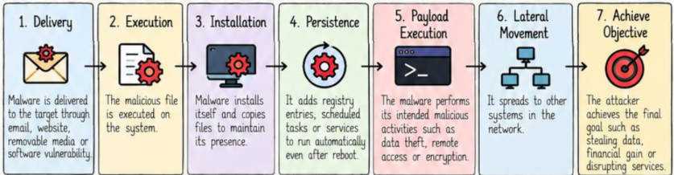


```
1. [Entrega (Delivery)]
   O malware alcança o alvo por e-mail, site, mídia removível ou vulnerabilidade de software.
                 ↓
2. [Execução (Execution)]
   O arquivo malicioso ou payload é executado no sistema.
                 ↓
3. [Instalação (Installation)]
   O malware instala-se e copia seus arquivos para consolidar presença.
                 ↓
4. [Persistência (Persistence)]
   Cria chaves de registro, tarefas agendadas ou serviços para rodar mesmo após reboot.
                 ↓
5. [Execução da Carga Útil (Payload Execution)]
   Executa suas atividades danosas (exfiltração de dados, criptografia, acesso remoto).
                 ↓
6. [Movimentação Lateral (Lateral Movement)]
   Propaga-se para outros dispositivos conectados à rede local.
                 ↓
7. [Conclusão do Objetivo (Achieve Objective)]
   O atacante conclui sua meta (exfiltração de dados, ganho financeiro ou paralisação).

```


### Etapas da Cyber Attack Chain (Kill Chain)
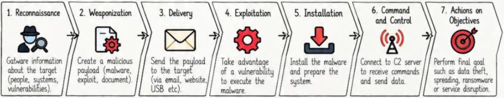
1. **Reconhecimento (Reconnaissance):** Coleta de informações sobre o alvo (usuários, servidores, sistemas, vulnerabilidades).

2. **Armamento (Weaponization):** Construção do artefato malicioso acoplado a um exploit ou código malicioso.

3. **Entrega (Delivery):** Envio do payload armado até o alvo (e-mail, website, pendrive USB).

4. **Exploração (Exploitation):** Exploração da vulnerabilidade técnica ou erro humano para executar o código.

5. **Instalação (Installation):** Instalação do malware no sistema para estabelecer base de operação.

6. **Comando e Controle (Command and Control - C2):** Abertura de canal de comunicação com os servidores do atacante.

7. **Ações nos Objetivos (Actions on Objectives):** Concretização dos objetivos (roubo de dados, chantagem com ransomware, interrupção de operações).

### Mapeamento: Processo de Infecção vs Cadeia de Ataque (Infection Process vs Attack Chain)

| Etapa do Processo de Infecção | Etapa da Cadeia de Ataque | Descrição |
| --- | --- | --- |
| **Entrega (*Delivery*)** | Entrega (*Delivery*) | O malware é entregue por meio de e-mail, site, USB, etc. |
| **Execução (*Execution*)** | Exploração (*Exploitation*) | O código malicioso é executado aproveitando uma vulnerabilidade ou por ação do usuário. |
| **Instalação (*Installation*)** | Instalação (*Installation*) | O malware é instalado no sistema. |
| **Persistência (*Persistence*)** | Instalação (*Installation*) | Mantém a presença no sistema usando o registro do Windows, tarefas agendadas, etc. |
| **Execução do Payload (*Payload Execution*)** | Comando e Controle (*Command and Control*) | Executa atividades maliciosas e comunica-se com o servidor C2. |
| **Movimentação Lateral (*Lateral Movement*)** | Ações nos Objetivos (*Actions on Objectives*) | Dispersa-se/propaga-se para outros sistemas dentro da rede. |
| **Alcançar o Objetivo (*Achieve Objective*)** | Ações nos Objetivos (*Actions on Objectives*) | Conclui o objetivo do invasor (roubo de dados, ransomware, etc.). |

### Técnicas Comuns Usadas em Cada Etapa (Common Techniques Used in Each Stage)

| Etapa (*Stage*) | Técnicas Comuns (*Common Techniques*) | 
| ----- | ----- | 
| **Reconhecimento (*Reconnaissance*)** | OSINT (inteligência de fontes abertas), redes sociais, varredura de rede (*network scanning*) | 
| **Armamento (*Weaponization*)** | Documentos maliciosos, kits de exploração (*exploit kits*), portas dos fundos (*backdoors*) | 
| **Entrega (*Delivery*)** | E-mails de phishing, sites maliciosos, USB infectado | 
| **Exploração (*Exploitation*)** | Vulnerabilidades de software, execução de macros, técnicas sem arquivo (*fileless*) | 
| **Instalação (*Installation*)** | Criação/injeção de arquivos (*dropping files*), modificação do registro, serviços | 
| **Persistência (*Persistence*)** | Pasta de inicialização (*startup folder*), tarefas agendadas, chaves de registro, rootkits | 
| **Comando e Controle (*Command and Control*)** | HTTP/HTTPS, encapsulamento de DNS (*DNS tunneling*), IRC, canais criptografados | 
| **Movimentação Lateral (*Lateral Movement*)** | *Pass-the-hash*, área de trabalho remota (*remote desktop*), roubo de credenciais | 
| **Ações nos Objetivos (*Actions on Objectives*)** | Exfiltração de dados, ransomware, DDoS, espionagem | 


### Exemplo do Mundo Real: De Phishing a Ransomware 
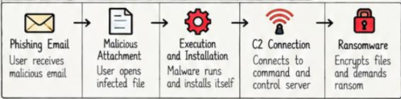
```
[E-mail de Phishing] 
O usuário recebe um e-mail com conteúdo enganoso.
         ↓
[Anexo Malicioso] 
O usuário abre um arquivo infectado anexado.
         ↓
[Execução e Instalação] 
O malware é executado e instala seus componentes no sistema.
         ↓
[Conexão C2] 
Estabelece comunicação com o servidor de comando e controle.
         ↓
[Ransomware] 
Criptografa arquivos do sistema e exige o resgate.

```

### Prevenção e Proteção 

* Manter prudência com mensagens de e-mail e links desconhecidos.

* Manter ferramentas antivírus e antimalware atualizadas.

* Aplicar patches de segurança no sistema operacional e em todos os softwares.

* Habilitar firewalls e monitoramento de tráfego de rede.

* Adotar listas de permissão (*application whitelisting*) e privilégios mínimos de acesso.

* Desativar a inicialização automática (*autorun*) para dispositivos USB.

* Monitorar ativamente comportamentos suspeitos e conexões anômalas.

* Manter rotinas de backups frequentes e isolados (backups offline).

## 13. Técnicas de Persistência em Malware 

### O que é Persistência em Malware? 

* Persistência é a capacidade demonstrada por um malware de manter sua presença e execução em um sistema mesmo após reinicializações, logoffs de usuários ou tentativas de remoção básica.

* Garante ao invasor a manutenção de acesso contínuo e a longo prazo ao ambiente invadido.

* Permite que as rotinas maliciosas sejam reexecutadas automaticamente sempre que a máquina reiniciar.

### Por que a Persistência é Utilizada? 

* Manter acesso contínuo ao host comprometido.

* Reiniciar as atividades maliciosas de modo automático após o boot.

* Dificultar a identificação e remoção da ameaça.

* Reestabelecer contato constante com o servidor C2.

* Conduzir operações de espionagem e roubo ao longo de meses ou anos (característico de APTs).

### Técnicas Comuns de Persistência de Malware (Common Malware Persistence Techniques)
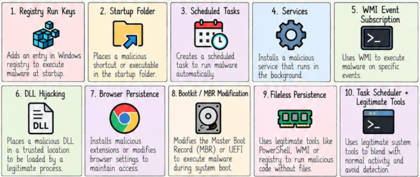

 1. **Registry Run Keys (Chaves Run do Registro):** Insere entradas no Registro do Windows para executar o binário na inicialização.

 2. **Startup Folder (Pasta de Inicialização):** Coloca atalhos ou executáveis maliciosos na pasta de inicialização do usuário ou do sistema.

 3. **Scheduled Tasks (Tarefas Agendadas):** Cria rotinas no Agendador de Tarefas do Windows para executar o malware em horários definidos ou em eventos de logon.

 4. **Services (Serviços):** Registra o malware como um serviço de sistema que inicia em segundo plano.

 5. **WMI Event Subscription (Inscrição em Eventos WMI):** Utiliza classes do WMI para invocar código malicioso mediante o acionamento de eventos específicos do sistema.

 6. **DLL Hijacking / DLL Side-Loading:** Posiciona uma DLL maliciosa com o mesmo nome de uma biblioteca legítima no diretório de uma aplicação confiável para ser carregada por ela.

 7. **Browser Persistence (Persistência em Navegador):** Adiciona extensões maliciosas ou sequestra atalhos e configurações de navegadores.

 8. **Bootkit / Modificação de MBR:** Altera o Master Boot Record (MBR) ou o ambiente UEFI para executar o código antes do próprio sistema operacional.

 9. **Fileless Persistence (Persistência Sem Arquivo):** Emprega chaves de registro, scripts e scripts WMI diretamente na memória para carregar código sem arquivos no disco.

10. **Task Scheduler + Ferramentas Legítimas:** Combina tarefas agendadas com binários do sistema para camuflar a execução maliciosa.

### Explicação Detalhada das Técnicas de Persistência (Detailed Explanation)

| Técnica | Como Funciona | Exemplo |
| ----- | ----- | ----- |
| **Chaves de Execução do Registro (*Registry Run Keys*)** | Adiciona um valor no registro para executar o malware durante a inicialização do sistema | `HKCU\Software\Microsoft\Windows\CurrentVersion\Run` |
| **Pasta de Inicialização (*Startup Folder*)** | Coloca um arquivo malicioso ou atalho na pasta de inicialização | `C:\Users\<user>\AppData\Roaming\Microsoft\Windows\Start Menu\Programs\Startup` |
| **Tarefas Agendadas (*Scheduled Tasks*)** | Cria uma tarefa para executar o malware em um horário ou evento específico | `schtasks /create /sc onlogon /tn "malware" /tr "malware.exe"` |
| **Serviços (*Services*)** | Instala um serviço malicioso no sistema operacional | `sc create malicious binPath= "C:\malware.exe" start= auto` |
| **Assinatura de Eventos WMI (*WMI Event Subscription*)** | Cria uma assinatura de evento para disparar a execução de código | Assinatura permanente de eventos WMI (*WMI permanent event subscription*) |
| **Sequestro de DLL (*DLL Hijacking*)** | Posiciona uma DLL maliciosa em um diretório considerado confiável | `Version.dll` colocada na pasta do próprio aplicativo |
| **Persistência em Navegadores (*Browser Persistence*)** | Instala extensões maliciosas ou modifica as configurações do navegador | Extensão para Chrome, alteração da página inicial |
| **Bootkit / MBR** | Modifica o setor de inicialização (*boot sector*) para executar o malware antes do SO | Modificação de MBR, bootkit UEFI |
| **Persistência Sem Arquivo (*Fileless Persistence*)** | Opera em memória ou aproveita ferramentas legítimas para manter presença | Scripts em PowerShell, chaves de registro, WMI |
| **Ferramentas Legítimas (*Legitimate Tools / LotL*)** | Emprega utilitários padrão do sistema para se camuflar no tráfego normal | `regsvr32`, `rundll32`, `mshta`, `certutil`, `schtasks` |

### Indicadores de Detecção 

* Entradas inesperadas nas chaves `Run` e `RunOnce` do Registro.

* Tarefas agendadas desconhecidas no Agendador de Tarefas.

* Criação de novos serviços do Windows sem assinatura válida ou com caminhos incomuns.

* Programas suspeitos na pasta de inicialização.

* Subscrições de eventos permanentes no WMI (`__EventFilter`, `__EventConsumer`).

* Presença de DLLs não oficiais nos diretórios de softwares instalados.

* Extensões desconhecidas ativas nos navegadores web.

* Alterações não autorizadas no setor MBR ou partições EFI.

* Chamadas suspeitas com binários legítimos (`PowerShell`, `regsvr32`, `wmic`).

* Conexões de rede persistentes com servidores de C2.

### Exemplos do Mundo Real 

1. **Emotet:** Usa chaves do Registro, tarefas agendadas e serviços para garantir persistência contínua.

2. **DarkComet:** Usa atalhos na pasta Startup e tarefas no Agendador de Tarefas.

3. **Stuxnet:** Emprega serviços de sistema, injeção de bibliotecas e drivers em nível de kernel (rootkit).

4. **FIN7:** Utiliza subscrições permanentes a eventos do WMI para persistência fileless.

5. **Bootkits:** Modificam diretamente o MBR ou partições UEFI.

6. **Extensões Maliciosas no Chrome:** Mantêm persistência dentro do navegador para injetar anúncios ou roubar cookies.

7. **Fileless Malware:** Carrega scripts diretamente de chaves de registro usando PowerShell.

### Prevenção e Proteção 

* Monitorar frequentemente tarefas agendadas e programas de inicialização.

* Usar ferramentas avançadas de antivírus e antimalware.

* Auditar modificações em tempo real no Registro do Windows.

* Desativar serviços desnecessários no sistema operacional.

* Bloquear ou restringir o uso de utilitários como `PowerShell`, `WMI` e `regsvr32` para usuários comuns.

* Manter o sistema operacional e os softwares devidamente atualizados.

* Aplicar políticas de controle de execução (*application whitelisting*).

* Monitorar a rede quanto a conexões anômalas contínuas.

## 14. Evasão de Malware e Ofuscação 

### O que é Evasão de Malware? (Malware Evasion)

* Evasão de malware compreende o conjunto de técnicas empregadas para contornar mecanismos de detecção, análise de segurança e processos de eliminação.

* Os atacantes usam esses métodos para burlar antivírus, ferramentas de detecção em tempo real e investigações forenses.

* Ajuda o malware a operar de modo camuflado e completar suas tarefas com sucesso.

* Frequentemente observada em campanhas de APTs e malwares modernos avançados.

### Técnicas Comuns de Evasão de Malware 
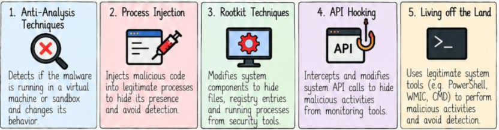
1. **Anti-Analysis Techniques (Técnicas Anti-Análise):** Detecta se o malware está em execução dentro de máquinas virtuais ou caixas de areia (*sandboxes*), alterando seu comportamento ou cessando a execução.

2. **Process Injection (Injeção de Processos):** Injeta código malicioso dentro do espaço de memória de processos legítimos (ex.: `explorer.exe`, `svchost.exe`) para mascarar a execução.

3. **Rootkit Techniques (Técnicas de Rootkit):** Intercepta e altera componentes do sistema para esconder arquivos, portas abertas e processos.

4. **API Hooking:** Intercepta e manipula chamadas de APIs do sistema operacional para esconder ações de ferramentas de monitoramento.

5. **Living off the Land:** Usa utilitários nativos e confiáveis do sistema operacional (`PowerShell`, `WMIC`, `CMD`) para executar ações danosas sem acionar alertas.

### O que é Ofuscação? 

* Ofuscação é o processo técnico de tornar o código de um programa difícil de compreender e analisar por analistas e scanners automatizados.

* Altera a estrutura visual e lógica do código sem alterar sua funcionalidade final.

* O objetivo central é encobrir as verdadeiras intenções e comandos do artefato malicioso.

* Frequentemente combinada com técnicas de evasão para dificultar a engenharia reversa.

### Técnicas Comuns de Ofuscação de Malware 
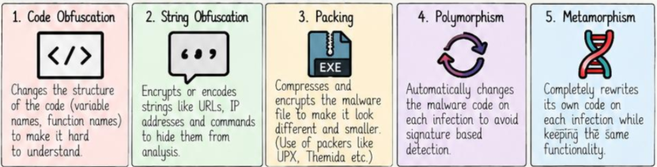
1. **Code Obfuscation (Ofuscação de Código):** Altera a estrutura do código (renomeando variáveis, reordenando rotinas e inserindo instruções inúteis/código morto) para confundir ferramentas de análise.

2. **String Obfuscation (Ofuscação de Strings):** Criptografa ou codifica textos legíveis (URLs, IPs, comandos, chaves de registro) para impedi-los de aparecer em ferramentas estáticas.

3. **Packing (Empacotamento):** Compacta e criptografa o executável malicioso; o arquivo descompacta a si próprio diretamente na memória durante a execução usando packers como UPX ou Themida.

4. **Polymorphism (Polimorfismo):** O código se altera automaticamente a cada nova infecção (geralmente mudando a rotina de decodificação/chave), alterando sua assinatura em hash para burlar scanners.

5. **Metamorphism (Metamorfismo):** Reescreve completamente toda a sua estrutura de código a cada compilação ou propagação, mantendo as mesmas funcionalidades práticas sem usar uma camada simples de packing.

### Diferenças Principais: Evasão vs Ofuscação 

| Aspecto | Evasão (*Evasion*) | Ofuscação (*Obfuscation*) | 
| ----- | ----- | ----- | 
| **Objetivo (*Goal*)** | Evitar detecção e análise | Tornar o código difícil de entender | 
| **Foco (*Focus*)** | Burlar ferramentas de segurança e monitoramento | Alterar a aparência do código sem mudar sua funcionalidade | 
| **Técnicas (*Techniques*)** | Antianálise, injeção de processos, rootkits, ocultação de arquivos, evasão de *sandbox* | Ofuscação de código, ofuscação de strings, empacotamento (*packing*), polimorfismo, metamorfismo | 
| **Nível (*Level*)** | Comportamental e ambiental | Nível de código | 
| **Usado em (*Used in*)** | Todos os tipos de malware | Frequentemente usado em conjunto com outras técnicas de evasão | 
| **Detecção (*Detection*)** | Mais difícil de detectar; requer análise comportamental | Pode ser detectado usando ferramentas de análise e desofuscação | 


### Métodos de Detecção 

* Análise comportamental e sandboxes avançadas.

* Análise estática e dinâmica combinada.

* Análise de memória volátil e inspeção contínua de processos.

* Detecção de chamadas anômalas de APIs ou comportamentos incomuns do sistema.

* Plataformas avançadas de segurança de endpoints (EDR, XDR).

* Regras YARA e algoritmos heurísticos projetados para identificar código ofuscado.

### Exemplos do Mundo Real 

1. **Emotet:** Utiliza técnicas de packing e motores polimórficos para gerar novas amostras.

2. **Stuxnet:** Fez uso intensivo de ofuscação de código e técnicas sofisticadas de evasão anti-análise.

3. **Cobalt Strike:** Utiliza injeção em memória em processos legítimos e execução via binários nativos.

4. **DarkComet:** Emprega ofuscação de strings de texto e detecção de ambientes de depuração.

5. **TrickBot:** Executáveis empacotados (*packed*) com carregamento direto na RAM e injeção sem arquivos.

6. **Ursnif:** Usa strings criptografadas e rotinas de interceptação (*hooking*) de chamadas de API.

7. **Famílias Modernas de Ransomware:** Combinam técnicas de ofuscação e evasão para impedir a detecção precoce antes da fase de criptografia.

### Prevenção e Proteção 

* Manter softwares e sistemas operacionais atualizados com as correções mais recentes.

* Adotar soluções de segurança com motores baseados em análise de comportamento.

* Habilitar proteção contínua contra atividades suspeitas em endpoints e redes.

* Restringir privilégios em ferramentas de linha de comando (`PowerShell`, `WMI`, `CMD`).

* Utilizar listas de permissão de aplicações (*application whitelisting*) e privilégio mínimo.

* Fazer varreduras regulares à procura de processos e arquivos anômalos.

## 15. Fundamentos da Análise de Malware 

### O que é Análise de Malware? 

* A análise de malware é o procedimento técnico de dissecação e investigação de um artefato malicioso para compreender seu funcionamento, propósitos e potenciais impactos.

* Auxilia na categorização de ameaças, criação de assinaturas, contenção de ataques e aprimoramento de defesas.

* É uma competência essencial para profissionais de resposta a incidentes (*incident response*), caça a ameaças (*threat hunting*) e engenharia reversa.

### Objetivos da Análise de Malware 

* Identificar com precisão as ações desempenhadas pelo software malicioso.

* Compreender seus mecanismos internos de funcionamento.

* Mensurar a gravidade e o impacto gerado nos sistemas e na infraestrutura.

* Extrair Indicadores de Comprometimento (IOCs - *Indicators of Compromise*).

* Descobrir meios adequados de detecção, bloqueio e mitigação.

* Desenvolver estratégias defensivas e planos de contenção de ameaças.

* Fornecer subsídios técnicos fundamentados para investigações forenses.

### Tipos de Análise de Malware 
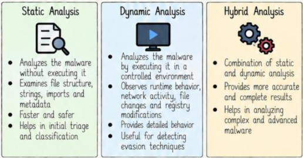
* **Análise Estática (Static Analysis):**

  * Analisa o arquivo sem executá-lo.

  * Examina a estrutura interna do arquivo, strings legíveis, bibliotecas importadas e metadados.

  * É um método rápido, seguro e ideal para triagens iniciais e categorização.

* **Análise Dinâmica (Dynamic Analysis):**

  * Analisa o malware executando-o em um ambiente estritamente controlado e isolado.

  * Observa o comportamento em tempo de execução, tráfego de rede gerado, criações de arquivos e alterações no registro.

  * Oferece visão ampla do comportamento prático e evidencia rotinas de evasão.

* **Análise Híbrida (Hybrid Analysis):**

  * Combina técnicas estáticas e dinâmicas de forma complementar.

  * Proporciona relatórios mais precisos, abrangentes e detalhados.

  * Facilita a análise de amostras avançadas, compactadas ou ofuscadas.

### Etapas Principais na Análise de Malware 
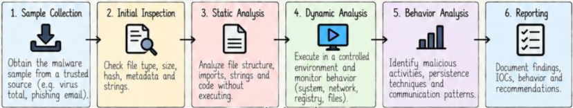
1. **Coleta da Amostra (Sample Collection):** Obtenção do arquivo a partir de fontes confiáveis (ex.: VirusTotal, anexos de e-mails em quarentena).

2. **Inspeção Inicial (Initial Inspection):** Validação de tipo de arquivo, tamanho, hashes criptográficos, metadados e strings básicas.

3. **Análise Estática (Static Analysis):** Inspeção de cabeçalhos, funções importadas/exportadas e disassembly do código sem execução.

4. **Análise Dinâmica (Dynamic Analysis):** Execução da amostra em ambiente isolado, monitorando alterações em arquivos, rede, processos e registro.

5. **Análise Comportamental (Behavior Analysis):** Identificação de ações danosas, mecanismos de persistência e fluxo de comunicação remota.

6. **Relatório (Reporting):** Documentação completa dos achados, incluindo IOCs, comportamento e recomendações de mitigação.

### O Ambiente de Análise de Malware (Malware Analysis Environment)
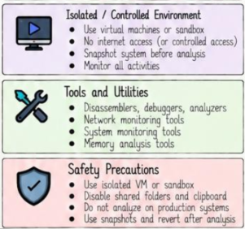
* **Ambiente Isolado e Controlado:**

  * Emprego de máquinas virtuais (VMs) dedicadas ou sandboxes.

  * Sem acesso à internet pública (ou utilizando conexões virtuais controladas/falsas).

  * Criação de instantâneos (*snapshots*) do sistema limpo antes de qualquer teste.

  * Registro de todas as atividades ocorridas.

* **Ferramentas e Utilitários:**

  * Desmontadores (*disassemblers*), depuradores (*debuggers*), utilitários de triagem.

  * Monitores de tráfego de rede e pacotes.

  * Monitores de processos, arquivos e registro.

  * Utilitários para extração e análise de memória RAM.

* **Precauções de Segurança:**

  * Trabalhar em VMs isoladas em rede exclusiva (*host-only* ou sem rede).

  * Desativar pastas compartilhadas (*shared folders*) e área de transferência compartilhada (*shared clipboard*).

  * Jamais realizar análises de malware em ambientes corporativos ou de produção.

  * Restaurar o snapshot limpo imediatamente após a conclusão da análise.

### Ferramentas comuns usadas na análise de Malware 


| Ferramenta  | Tipo   | Finalidade   | 
| ----- | ----- | ----- | 
| **VirusTotal** | Online | Varredura com múltiplos motores antivírus e análise de arquivos | 
| **PEstudio** | Estática   | Analisar a estrutura de arquivos PE (*Portable Executable*) e seus indicadores | 
| **CFF Explorer** | Estática   | Inspecionar e editar arquivos PE | 
| **strings** | Estática   | Extrair sequências de caracteres legíveis (*strings*) | 
| **Ghidra** | Estática   | Engenharia reversa (desassemblador / descompilador) | 
| **IDA Pro** | Estática   | Desassemblagem avançada e análise de código | 
| **x64dbg / OllyDbg** | Dinâmica   | Depuração (*debugging*) e análise em tempo de execução | 
| **Process Monitor** | Dinâmica   | Monitorar atividades de arquivos, registro do sistema e processos | 
| **Wireshark** | Dinâmica   | Análise de tráfego de rede | 
| **Regshot** | Dinâmica   | Comparar alterações no registro do sistema | 
| **INetSim** | Dinâmica   | Simular serviços de rede (internet simulada/falsa) | 
| **Cuckoo Sandbox** | Dinâmica   | Análise dinâmica e automatizada de malware | 
| **Volatility** | Memória | Perícia forense em memória e análise de malware | 


### Artefatos importantes a serem analisados 
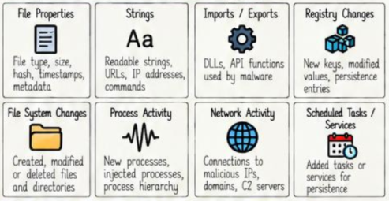
* **Propriedades do Arquivo (File Properties):** Tipo de arquivo, dimensões, hashes criptográficos, data e hora (*timestamps*), certificados e metadados.

* **Strings:** Palavras legíveis, URLs, endereços IP, linhas de comando, mensagens de erro e parâmetros.

* **Imports/Exports:** Bibliotecas DLL vinculadas e APIs nativas consumidas pelo programa.

* **Alterações no Sistema de Arquivos (File System Changes):** Arquivos criados, alterados ou removidos em diretórios do sistema.

* **Atividade de Processos (Process Activity):** Novos processos gerados, árvores de processos, processos injetados.

* **Atividade de Rede (Network Activity):** Tentativas de conexão externa, requisições DNS, servidores C2 contactados.

* **Alterações no Registro (Registry Changes):** Novas chaves, modificações em chaves de inicialização do sistema.

* **Tarefas Agendadas e Serviços (Scheduled Tasks/Services):** Mecanismos criados para viabilizar persistência contínua.

### Indicadores de Comprometimento Comuns (Common Indicators of Compromise - IOCs)
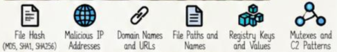

* **Hashes de Arquivo:** MD5, SHA1, SHA256.

* **Endereços IP Maliciosos e URLs:** Servidores remotos de controle e páginas maliciosas.

* **Nomes de Domínio:** Domínios de C2 e pontos de distribuição.

* **Caminhos de Arquivos e Nomes de Binários:** Localizações onde o malware deposita seus componentes.

* **Chaves e Valores de Registro:** Entradas alteradas para persistência ou desativação de recursos.

* **Mutexes e Padrões de Tráfego:** Nomes de mutexes usados para controle de execução única e assinaturas de pacotes de C2.

### Melhores práticas para análise de Malware 

* Sempre operar em ambiente isolado, controlado e sem conexão desprotegida à rede.

* Manter o sistema e as ferramentas de análise rigorosamente atualizados.

* Utilizar abordagem mista, combinando técnicas estáticas e dinâmicas.

* Registrar e documentar todos os passos, alterações e IOCs identificados.

* Atentar-se a possíveis manobras de anti-análise e evasão do malware.

* Validar hipóteses comparando os resultados entre múltiplas ferramentas analíticas.

* Respeitar diretrizes éticas e requisitos legais durante o manuseio das ameaças.

* Compartilhar IOCs com o ecossistema de defesa para fortalecer a proteção geral.

## 16. Análise Estática e Análise Dinâmica 

### O que é Análise Estática? 

* A análise estática consiste na avaliação detalhada de um artefato malicioso sem que ele seja colocado em execução.

* Investiga aspectos estruturais do arquivo, instruções de código, strings legíveis, tabelas de importação, metadados e assinaturas digitais.

* Ajuda a levantar hipóteses funcionais, potenciais capacidades e indicadores preliminares de comprometimento.

* Caracteriza-se por ser uma abordagem ágil e segura, pois o código nunca assume o controle do processador.

### Processo de Análise Estática (Static Analysis Process)
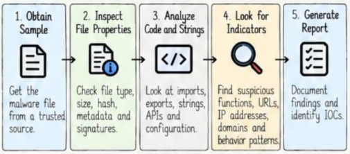
1. **Obter Amostra (Obtain Sample):** Baixar o arquivo suspeito de um repositório seguro.

2. **Inspecionar Propriedades do Arquivo (Inspect File Properties):** Checar tipo de extensão real, tamanho em bytes, hashes (MD5, SHA256) e assinaturas.

3. **Analisar Código e Strings (Analyze Code and Strings):** Inspecionar tabelas de importação/exportação, chamadas de APIs e strings de texto.

4. **Buscar Indicadores (Look for Indicators):** Identificar funções perigosas, endereços IP, domínios e padrões estruturais.

5. **Gerar Relatório (Generate Report):** Registrar de forma organizada todos os IOCs levantados e funcionalidades prováveis.

### O que se Pode Descobrir na Análise Estática?  
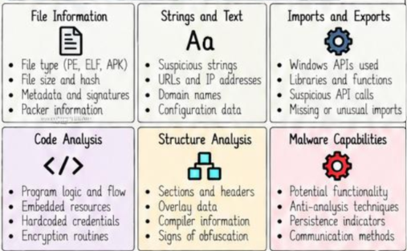
* **Informações do Arquivo:** Formato do arquivo (PE, ELF, APK), dimensões, hashes criptográficos, assinaturas e indícios de empacotadores (*packers*).

* **Análise de Strings:** URLs embutidas, endereços IP, nomes de arquivos, mensagens de depuração e variáveis.

* **Importações e Exportações:** APIs do Windows utilizadas, bibliotecas DLL vinculadas, funções de rede ou injeção de processos.

* **Análise Estrutural:** Seções do binário (`.text`, `.data`, `.rsrc`), anomalias em cabeçalhos e entropia de dados (indício de criptografia ou compactação).

* **Capacidades Potenciais:** Hipóteses sobre o comportamento do programa, rotinas anti-análise e mecanismos de persistência.

### Ferramentas Populares para Análise Estática 

| Ferramenta  | Tipo   | Finalidade  |
| --- | --- | --- |
| **PEstudio** | Estática   | Analisar a estrutura e indicadores de arquivos PE |
| **CFF Explorer** | Estática   | Inspecionar e editar arquivos PE |
| **strings** | Estática   | Extrair cadeias de caracteres legíveis de arquivos |
| **IDA Pro** | Estática   | Desassemblar e analisar código |
| **Ghidra** | Estática   | Engenharia reversa e análise de código |
| **Detect It Easy** | Estática   | Detectar empacotadores (*packers*) e informações de compilação |
| **Exeinfo PE** | Estática   | Exibir informações do arquivo e detalhes sobre o empacotador |
| **YARA** | Estática   | Correspondência de padrões para detecção de malware | 

### O que é Análise Dinâmica? 

* A análise dinâmica consiste no estudo do comportamento do malware colocando-o em execução real dentro de um ambiente seguro e controlado (sandbox ou máquina virtual isolada).

* Observa as ações desempenhadas pelo artefato em tempo de execução (*runtime*).

* Revela com precisão o que o malware de fato faz no sistema quando ativo.

* Registra alterações efetuadas em disco, manipulações de chaves de registro, tráfego de rede gerado e novos processos disparados.

### Processo de Análise Dinâmica  
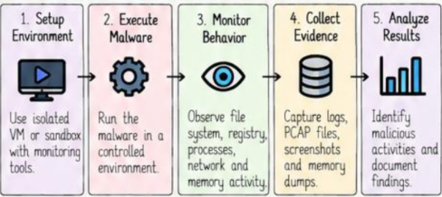
1. **Configurar o Ambiente (Setup Environment):** Preparar uma máquina virtual ou sandbox isolada com ferramentas de monitoramento ativas e criar um snapshot limpo.

2. **Executar o Malware (Execute Malware):** Disparar o arquivo suspeito dentro do ambiente controlado.

3. **Monitorar o Comportamento (Monitor Behavior):** Observar criações de arquivos, manipulação do registro, conexões de rede e processos.

4. **Coletar Evidências (Collect Evidence):** Salvar arquivos de captura de rede (PCAP), logs de eventos, capturas de tela e dumps de memória.

5. **Analisar Resultados (Analyze Results):** Interpretar as ações observadas e consolidar o relatório final.

### O que se Pode Descobrir na Análise Dinâmica? (What can we find in Dynamic Analysis?)
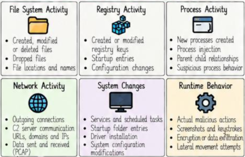

* **Atividade no Sistema de Arquivos:** Arquivos criados, apagados ou sobrescritos; arquivos baixados (*dropped files*).

* **Atividade no Registro:** Criação e alteração de valores de chaves de registro, em especial rotinas de inicialização.

* **Atividade de Processos:** Novos processos filhos criados, processos legítimos sofrendo injeção, hierarquia de chamadas.

* **Atividade de Rede:** Tentativas de comunicação externa, resolução de DNS para C2, volumes e tipos de dados transmitidos.

* **Comportamento em Execução:** Captura de teclas e telas, rotinas de criptografia de dados em lote ou tentativas de propagação na rede local.

### Ferramentas Populares para Análise Dinâmica 


| Ferramenta   | Tipo   | Finalidade   |
| ----- | ----- | ----- |
| **VirusTotal (Behavior)** | Dinâmica   | Executar amostra em sandbox na nuvem |
| **Cuckoo Sandbox** | Dinâmica   | Plataforma automatizada de análise de malware |
| **ANY.RUN** | Dinâmica   | Sandbox online interativa |
| **ProcMon (Process Monitor)** | Dinâmica   | Monitorar atividades de arquivos, registro e processos |
| **Wireshark** | Dinâmica   | Capturar e analisar o tráfego de rede |
| **Regshot** | Dinâmica   | Comparar alterações no registro do sistema |
| **Process Explorer** | Dinâmica   | Monitorar processos em execução e DLLs |
| **FakeNet / INetSim** | Dinâmica   | Simular serviços de rede para análise offline |

### Tabela Comparativa: Análise Estática vs Dinâmica  

| Aspecto (*Aspect*) | Análise Estática   | Análise Dinâmica   | 
| ----- | ----- | ----- | 
| **Execução** | Não é executado | Executado em ambiente controlado | 
| **Segurança** | Seguro | Arriscado (utilize uma *sandbox*) | 
| **Velocidade** | Mais rápida | Mais lenta | 
| **Informações obtidas** | Estrutura do arquivo, código, sequências de texto (*strings*) | Comportamento em tempo de execução, alterações no sistema | 
| **Ambiente** | Não requer configuração especial | Requer máquina virtual (VM) ou *sandbox* | 
| **Detecção** | Identifica comportamento potencial | Mostra o comportamento real | 
| **Limitações** | Não permite visualizar o comportamento em tempo de execução | Pode ser burlada por técnicas antianálise | 
| **Caso de Uso** | Triagem inicial e análise rápida | Análise comportamental detalhada | 
 

### Exemplos do Mundo Real (Real World Examples)

1. **Emotet:** A análise estática indica a presença de bibliotecas suspeitas e strings compactadas; a análise dinâmica expõe requisições web para servidores C2.

2. **TrickBot:** A análise dinâmica captura conexões persistentes para infraestruturas de controle do invasor.

3. **WannaCry:** A análise estática permitiu localizar o domínio em texto plano referente ao mecanismo de *kill switch*.

4. **Cobalt Strike:** A análise dinâmica demonstra injeções de código em processos legítimos e o padrão de *beaconing*.

5. **DarkComet:** A análise estática aponta APIs de controle de teclado e tela; a dinâmica monitora a conexão remota ativa.

6. **Zeus:** A análise estática descobre URLs de configuração; a dinâmica demonstra a captura de formulários web bancários.

7. **Ransomware em Geral:** A análise dinâmica documenta o momento exato em que arquivos começam a ser renomeados e encriptados.

### Melhores Práticas  

* Combinar ambas as técnicas (estática e dinâmica) para resultados precisos.

* Sempre realizar testes em ambientes estritamente isolados e controlados.

* Manter ferramentas e sistemas analíticos devidamente atualizados.

* Buscar ativamente por IOCs e comportamentos fora do padrão.

* Manter atenção constante a possíveis contramedidas anti-análise do malware.

* Documentar todos os procedimentos e achados com clareza.

* Agir estritamente dentro dos parâmetros legais e éticos vigentes.

## 17. Sandboxing e Fundamentos da Engenharia Reversa (Sandboxing + Reverse Engineering Basics)

### O que é Sandboxing? 

* Sandboxing é uma metodologia de segurança que executa programas e arquivos suspeitos em um ambiente estritamente isolado e monitorado.

* Previne que o código em análise cause qualquer prejuízo aos sistemas reais ou à rede de produção, ao mesmo tempo em que permite registrar todas as suas ações.

* Permite analisar com segurança artefatos maliciosos de modo estático e dinâmico.

### Recursos-Chave do Sandboxing 
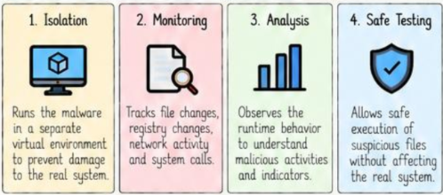
1. **Isolamento (Isolation):** Isola a execução do código em um contêiner ou máquina virtual para blindar o sistema host de qualquer impacto nocivo.

2. **Monitoramento (Monitoring):** Registra de maneira detalhada chamadas de sistema, criação de arquivos, alterações de registro e tráfego de dados na rede.

3. **Análise (Analysis):** Avalia as ações desempenhadas pelo artefato em tempo de execução para revelar intenções nocivas e gerar indicadores.

4. **Ambiente Seguro de Testes (Safe Testing):** Proporciona espaço para testes dinâmicos controlados sem colocar em risco a rede ou dados reais.

### Tipos de Sandboxing 
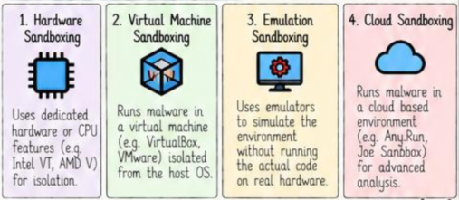
1. **Hardware Sandboxing:** Usa recursos físicos dedicados ou instruções da CPU (Intel VT, AMD-V) para isolar completamente a camada de execução.

2. **Virtual Machine Sandboxing:** Executa o malware em sistemas virtualizados (VMware, VirtualBox) desconectados da rede externa.

3. **Emulation Sandboxing:** Emprega emuladores de software que simulam o hardware e o sistema operacional, interceptando instruções sem executá-las no processador real.

4. **Cloud Sandboxing:** Utiliza infraestruturas baseadas em nuvem (ex.: Any.Run, Joe Sandbox) preparadas para processar e analisar amostras em larga escala com relatórios automáticos.

### Ferramentas Populares de Sandboxing (Popular Sandboxing Tools)

 Ferramenta  | Tipo   | Finalidade / Recursos   |
| ----- | ----- | ----- |
| **Any.Run** | Nuvem  | Análise interativa de malware, monitoramento de rede e de processos |
| **Joe Sandbox** | Nuvem   | Análise dinâmica avançada, relatórios detalhados |
| **Cuckoo Sandbox** | Código Aberto   | Análise automatizada de malware em ambiente virtual |
| **VMware / VirtualBox** | Máquina Virtual | Criação de máquinas virtuais isoladas para análise manual |
| **Windows Sandbox** | Integrado (*Built-in*) | Sandbox leve integrada no Windows 10/11 |
| **Firejail** | Linux | Sandboxing para aplicativos Linux |
| **INetSim** | Rede   | Simula serviços de internet para malware |
| **Detux** | Código Aberto   | Análise dinâmica automatizada com geração de relatórios |

### O que é Engenharia Reversa? 

* Engenharia reversa no contexto de malware é o procedimento analítico de desmontar um arquivo binário compilado para compreender sua arquitetura, algoritmos e funcionamento interno.

* Estuda o código de baixo nível, a sequência lógica de execução e as estruturas de dados manipuladas.

* Possibilita compreender exatamente funções maliciosas ocultas, contornar mecanismos de proteção e produzir regras e assinaturas de detecção refinadas.

* Amplamente aplicada na análise de ameaças, pesquisa de vulnerabilidades (*vulnerability research*) e auditoria de softwares.

### Aspectos principais da Engenharia Reversa 
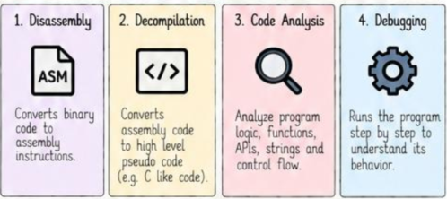
1. **Desmontagem (Disassembly):** Converte o código binário (linguagem de máquina) em instruções legíveis de linguagem assembly (ASM).

2. **Descompilação (Decompilation):** Transforma as instruções em assembly em uma representação em pseudocódigo de alto nível (geralmente semelhante a C/C++).

3. **Análise de Código (Code Analysis):** Avalia a lógica dos fluxos do programa, APIs invocadas, cadeias de strings e estruturas condicionais.

4. **Depuração (Debugging):** Executa o binário de modo controlado, instrução por instrução, inspecionando registradores e memória para contornar verificações e validar seu fluxo.

### Processo de Engenharia Reversa 
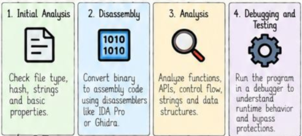
1. **Análise Inicial (Initial Analysis):** Identificar formato do arquivo, hashes criptográficos, metadados e strings básicas legíveis.

2. **Desmontagem (Disassembly):** Carregar o binário em ferramentas como IDA Pro ou Ghidra para converter bytes em código assembly.

3. **Análise (Analysis):** Mapear chamadas de APIs do sistema operacional, referências a strings, árvores de funções e tabelas de decisão lógicas.

4. **Depuração e Testes (Debugging and Testing):** Executar o malware em depuradores (x64dbg) para avaliar o fluxo de execução e desarmar proteções anti-análise.

### Ferramentas Populares de Engenharia Reversa (Popular Reverse Engineering Tools)

| Ferramenta   | Tipo   | Finalidade / Recursos  |
| ----- | ----- | ----- |
| **IDA Pro** | Desassemblador (*Disassembler*) | Desassemblagem avançada e análise de código |
| **Ghidra** | Desassemblador (*Disassembler*) | Desassemblador de código aberto desenvolvido pela NSA |
| **Radare2** | *Framework* | *Framework* de engenharia reversa com depurador (*debugger*) integrado |
| **x64dbg / x32dbg** | Depurador (*Debugger*) | Depurador para Windows focado em análise em tempo de execução (*runtime*) |
| **OllyDbg** | Depurador (*Debugger*) | Depurador clássico para binários do Windows (32-bit) |
| **PEstudio** | Análise Estática (*Static Analysis*) | Analisa arquivos PE e localiza indicadores suspeitos |
| **CFF Explorer** | Análise Estática (*Static Analysis*) | Inspeciona e edita a estrutura interna de arquivos PE |
| **strings** | Linha de Comando (*Command Line*) | Extrai sequências de texto legíveis a partir de binários |
| **Binwalk** | Análise de *Firmware* (*Firmware Analysis*) | Extrai e analisa arquivos incorporados (*embedded files*) |

### Exemplos do Mundo Real (Real World Examples)
### [Exemplo: Fluxo de Sandboxing]
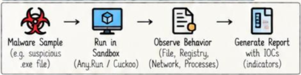
```

Amostra de Malware (arquivo suspeito .exe)
                   ↓
      Executar na Sandbox (ANY.RUN / Cuckoo)
                   ↓
      Observar Comportamento (Arquivos, Registro, Rede, Processos)
                   ↓
      Gerar Relatório com IOCs e Métricas


```
### [Exemplo: Fluxo de Engenharia Reversa]
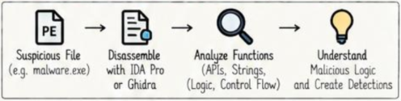
```
[Exemplo: Fluxo de Engenharia Reversa]
Arquivo Suspeito (ex.: malware.exe)
                   ↓
      Desmontar com IDA Pro ou Ghidra
                   ↓
      Analisar Funções (APIs, Strings, Lógica, Fluxo de Controle)
                   ↓
      Compreender Lógica Maliciosa e Criar Regras de Detecção

```

### Tabela Comparativa: Sandboxing vs Engenharia Reversa

| Aspecto   | Sandboxing | Engenharia Reversa   | 
| ----- | ----- | ----- | 
| **Objetivo** | Observar o comportamento de forma segura | Compreender a lógica interna do código | 
| **Execução** | Executa o malware | Analisa o código (pode ou não executar) | 
| **Ambiente** | Máquina virtual isolada (VM) / emulador | Ferramentas de desassemblagem (*disassemblers*), depuradores (*debuggers*) | 
| **Resultado / Saída** | Relatório de comportamento, IOCs | Lógica do código, algoritmos, funcionalidade | 
| **Caso de Uso** | Análise dinâmica | Análise estática e dinâmica | 

### Melhores Práticas  

* Sempre manipular artefatos maliciosos em ambientes isolados e estritamente controlados.

* Manter utilitários de análise e sandboxes atualizados com os últimos patches.

* Combinar dados comportamentais da sandbox com a inspeção estática da engenharia reversa.

* Cruzar informações obtidas através de múltiplas ferramentas independentes.

* Estar atento a técnicas anti-análise, evasão de VM e anti-debugging embutidas.

* Documentar detalhadamente todas as funções mapeadas e indicadores extraídos.

* Atuar sempre em estrita conformidade com as políticas éticas e normas legais aplicáveis.

## 18. Detecção e Prevenção de Malware 

### O que é Detecção de Malware? 

* Detecção de malware é o conjunto de procedimentos e tecnologias aplicados para reconhecer a presença de softwares maliciosos ou atividades anômalas em um sistema ou infraestrutura de rede.

* Baseia-se em assinaturas estáticas, heurísticas, análise de comportamento, inteligência artificial/aprendizado de máquina (AI/ML) e inteligência de ameaças (*threat intelligence*).

* Atua na identificação e contenção do malware antes, durante ou logo após a execução.

* Opera no nível de arquivos, processos, fluxos de tráfego de rede e anomalias de comportamento.

### Onde a Detecção é aplicada? 
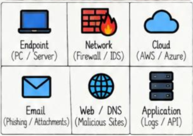
* **Endpoints (PC/Servidores):** Monitoramento de processos, arquivos e integridade do sistema.

* **Rede (Firewall/IDS):** Inspeção de fluxos de pacotes e assinaturas de ataques em trânsito.

* **Nuvem (AWS/Azure):** Análise de logs de serviços e monitoramento de cargas de trabalho em nuvem.

* **E-mail:** Filtros de spam, verificação de anexos e detecção de phishing.

* **Web/DNS:** Filtros de URL maliciosas e inspeção de requisições de DNS anômalas.

* **Aplicações:** Auditoria contínua de chamadas de APIs e registros de transações em aplicações.

### Tipos de Detecção de Malware 
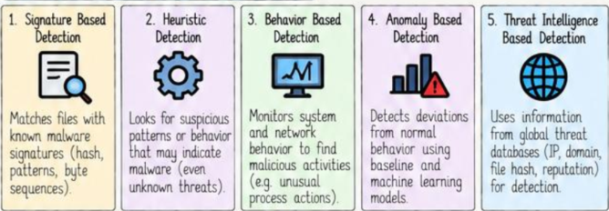
1. **Signature-Based Detection (Detecção Baseada em Assinatura):** Compara arquivos contra uma base de assinaturas conhecidas (hashes criptográficos, sequências de bytes e padrões estruturais específicos).

2. **Heuristic Detection (Detecção Heurística):** Procura por trechos de código, comandos ou instruções característicos frequentemente associados a softwares danosos, identificando novas variantes.

3. **Behavior-Based Detection (Detecção Baseada em Comportamento):** Monitora em tempo real ações suspeitas do sistema e de processos (ex.: injeção de processos, alterações não autorizadas no registro).

4. **Anomaly-Based Detection (Detecção Baseada em Anomalia):** Cria linhas de base (*baselines*) do tráfego ou comportamento normal e aciona alertas sempre que ocorrem desvios estatísticos significativos usando Machine Learning.

5. **Threat Intelligence-Based Detection (Detecção Baseada em Inteligência de Ameaças):** Cruza artefatos locais com repositórios globais com reputação de endereços IP, domínios maliciosos e hashes confirmados.

### Ferramentas Comuns de Detecção (Common Tools for Detection)

| Ferramenta   | Tipo   | Finalidade / Recursos   |
| --- | --- | --- |
| **Windows Defender** | Endpoint | Proteção em tempo real e detecção baseada em assinaturas |
| **VirusTotal** | Online | Varredura de arquivos, URLs e IPs com múltiplos motores de antivírus |
| **Snort** | IDS (Sistema de Detecção de Intrusão) | Detecção de intrusão e malware baseada em rede |
| **Suricata** | IDS / IPS (Detecção e Prevenção de Intrusão) | Detecção avançada de ameaças de rede |
| **ELK Stack** | SIEM (Gerenciamento de Eventos e Informações de Segurança) | Análise de logs e detecção de ameaças |
| **CrowdStrike** | EDR (Detecção e Resposta de Endpoint) | Detecção em endpoints baseada em comportamento |
| **YARA** | Análise de Arquivos (*File Analysis*) | Correspondência de padrões para detecção de malware |
| **Cuckoo Sandbox** | Sandbox | Análise dinâmica e detecção de comportamento |
| **Zeek** | Rede (*Network*) | Análise e detecção de tráfego de rede |

### O que é Prevenção de Malware? 

* Prevenção de malware compreende as políticas, configurações e controles proativos implementados para impedir que códigos maliciosos consigam penetrar, executar ou se disseminar nos sistemas.

* Envolve endurecimento de configurações (*system hardening*), aplicação rigorosa de controles de acesso e isolamento defensivo.

* Reduz a superfície de ataque e intercepta ameaças antes que tenham chance de causar danos.

* É consideravelmente mais eficaz e financeiramente econômica do que tratar infecções consolidadas.

### Onde a Prevenção é aplicada? 
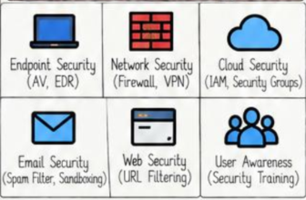
* **Segurança de Endpoints:** Soluções de antivírus e agentes EDR com capacidade de bloqueio preventivo.

* **Segurança de Rede:** Regras de firewall, segmentação de rede e gateways VPN seguros.

* **Segurança em Nuvem:** Gestão de identidade e acessos (IAM) e Grupos de Segurança (*Security Groups*).

* **Segurança de E-mail:** Gateways de e-mail seguros com descarte preventivo de anexos perigosos.

* **Segurança Web:** Filtros de navegação que bloqueiam o carregamento de categorias e sites de risco.

* **Conscientização dos Usuários:** Treinamentos periódicos focados na identificação de fraudes e phishing.

### Tipos de Prevenção de Malware 
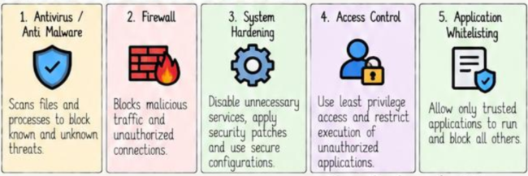
1. **Antivirus / Anti-Malware:** Escaneia arquivos em tempo real e bloqueia o acesso a ameaças conhecidas e desconhecidas.

2. **Firewall:** Filtra o tráfego de entrada e saída, impedindo comunicações não autorizadas.

3. **System Hardening (Endurecimento de Sistema):** Desativação de serviços desnecessários, fechamento de portas ociosas e aplicação regular de patches.

4. **Access Control (Controle de Acesso):** Aplicação rígida do princípio do menor privilégio, impedindo execuções administrativas sem autorização.

5. **Application Whitelisting (Listas de Permissão de Aplicações):** Configuração em que apenas programas explicitamente catalogados têm permissão para rodar, bloqueando qualquer outro binário.


### Ferramentas Comuns de Prevenção (Common Tools for Prevention)

| Ferramenta   | Tipo   | Finalidade / Recursos   |
| ----- | ----- | ----- |
| **Windows Defender** | Antivírus   | Prevenção de malware em tempo real |
| **Bitdefender** | Antivírus   | Proteção avançada de endpoints |
| **Firewall (Windows)** | Firewall | Bloqueia tráfego não autorizado |
| **pfSense** | Firewall | Segurança de rede e controle de tráfego |
| **AppLocker** | Lista de Permissões (*Whitelisting*) | Permite apenas a execução de aplicativos confiáveis |
| **SELinux** | Fortalecimento do Sistema (*System Hardening*) | Controle de acesso obrigatório (Linux) |
| **UFW** | Firewall | Firewall descomplicado para Linux (*Uncomplicated Firewall*) |
| **WSUS** | Gerenciamento de Patches (*Patch Management*) | Implantação de atualizações de segurança (Windows) |
| **CrowdStrike Falcon** | EDR (Detecção e Resposta de Endpoint) | Previne e interrompe ameaças avançadas | 

### Tabela Comparativa: Detecção vs Prevenção 

 Aspecto   | Detecção   | Prevenção   | 
| ----- | ----- | ----- | 
| **Objetivo** | Encontrar atividades maliciosas | Interromper atividades maliciosas | 
| **Momento** | Durante ou após a execução | Antes da execução | 
| **Abordagem** | Identificar e alertar | Bloquear e reduzir o risco | 
| **Técnicas** | Assinaturas, heurística, comportamento, AM (*Machine Learning*), inteligência contra ameaças (*threat intelligence*) | Antivírus, firewall, fortalecimento do sistema (*hardening*), controle de acesso, listas de permissões (*whitelisting*) | 
| **Caso de Uso** | Resposta a incidentes, computação forense | Reduzir a superfície de ataque | 
| **Ferramentas de Exemplo** | Snort, VirusTotal, YARA, ELK | Firewall, Defender, AppLocker | 
| **Resultado** | Detecção e visibilidade | Prevenção e proteção | 


### Exemplos do Mundo Real 

1. Ransomware interceptado e barrado por software antivírus com base em sua assinatura estática.

2. Arquivo desconhecido submetido a uma sandbox que identifica seu comportamento nocivo e o cataloga.

3. Firewall corporativo bloqueando imediatamente conexões para um endereço IP listado como C2.

4. E-mail de phishing com anexo infectado bloqueado preventivamente no gateway de mensageria.

5. Processo de injeção em memória interrompido e finalizado por um sensor EDR.

6. Binário desconhecido que tenta executar no sistema e é impedido por políticas do AppLocker.

7. Malware de dia zero (*zero-day*) detectado e bloqueado por motores de comportamento heurístico.

### Melhores Práticas

* Manter antivírus e soluções de segurança de endpoint sempre atualizados.

* Aplicar patches de segurança de sistemas e aplicações com regularidade.

* Utilizar firewalls ativos e monitorar logs de rede.

* Adotar políticas de listas de permissão de aplicações (*application whitelisting*).

* Centralizar logs em plataformas SIEM para detecção correlacionada.

* Utilizar sandboxes para inspecionar anexos e executáveis de origem duvidosa.

* Manter cópias de segurança (backups) testadas e um plano formal de resposta a incidentes.

* Capacitar usuários com treinamentos focados na identificação de fraudes e engenharia social.

## 19. Resposta a Incidentes e  Remoção de Malware 

### O que é Resposta a Incidentes de Malware?  

* Resposta a incidentes de malware é o procedimento técnico estruturado para detectar, analisar, conter e recuperar sistemas e redes após uma infecção ou violação de segurança.

* Possui como propósito conter danos operacionais, eliminar por completo os artefatos maliciosos e evitar novas contaminações.

* Baseia-se em metodologias com etapas bem definidas e atribuições pré-estabelecidas para as equipes.

* Integra o plano corporativo global de continuidade de negócios e segurança cibernética.

### Ciclo de Vida de Resposta a Incidentes (NIST Framework)
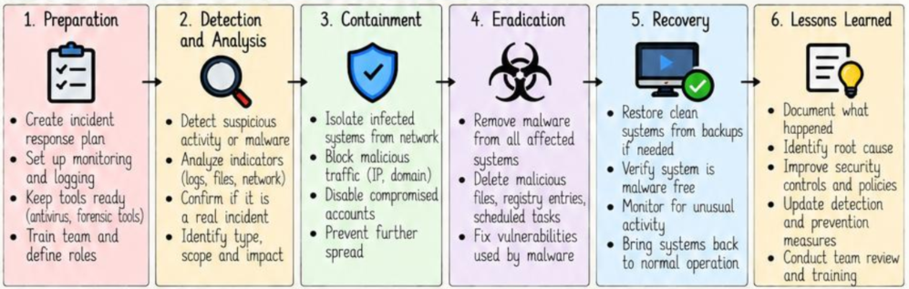
```
1. [Preparação (Preparation)]
   - Criação do plano formal de resposta a incidentes.
   - Implementação e validação de ferramentas de monitoramento e auditoria de logs.
   - Manutenção de ferramentas de prontidão (antivírus, kits forenses).
   - Treinamento contínuo das equipes e definição clara de responsabilidades.
                 ↓
2. [Detecção e Análise (Detection and Analysis)]
   - Identificação de atividades anômalas ou presença de malware.
   - Análise criteriosa de indicadores (logs de sistemas, arquivos, capturas de rede).
   - Confirmação da legitimidade do incidente (evitando falsos positivos).
   - Determinação do tipo de ameaça, escopo da invasão e gravidade do impacto.
                 ↓
3. [Contenção (Containment)]
   - Isolamento imediato dos sistemas comprometidos da rede corporativa.
   - Bloqueio de conexões de tráfego malicioso em firewalls (endereços IP e domínios C2).
   - Desativação ou revogação de credenciais e contas de usuário comprometidas.
   - Adoção de barreiras que impeçam a propagação lateral da ameaça.
                 ↓
4. [Erradicação (Eradication)]
   - Exclusão do malware e de todos os componentes associados dos hosts infectados.
   - Eliminação de binários nocivos, chaves de registro residuais e tarefas agendadas.
   - Correção e fechamento das vulnerabilidades e brechas utilizadas na intrusão inicial.
                 ↓
5. [Recuperação (Recovery)]
   - Restauração de sistemas afetados a partir de backups confiáveis e validados.
   - Validação rigorosa garantindo que o ambiente está totalmente isento de ameaças.
   - Monitoramento intensivo para detectar reincidências imediatas.
   - Retorno planejado dos sistemas à operação produtiva regular.
                 ↓
6. [Lições Aprendidas (Lessons Learned)]
   - Registro minucioso do histórico do incidente em relatório técnico.
   - Identificação da causa-raiz da infecção (*root cause*).
   - Revisão e aprimoramento das políticas e controles defensivos da organização.
   - Atualização dos mecanismos de detecção e processos de resposta.
   - Reunião de pós-incidente e alinhamento com a equipe de operações.

```

### O que é Remoção de Malware?

* Remoção de malware é a eliminação definitiva de todos os componentes, arquivos e processos maliciosos presentes em um host infectado.

* Abrange o mapeamento de todos os módulos instalados pelo malware, seu expurgo e a restauração das condições normais de funcionamento do sistema.

* Inclui a reversão de modificações indesejadas executadas nos arquivos, no registro, nos serviços e nas configurações do sistema operacional.

* Uma eliminação minuciosa anula riscos de reinfecção e assegura que a máquina volte a operar em nível confiável.

### Processo de Remoção de Malware Passo a Passo 
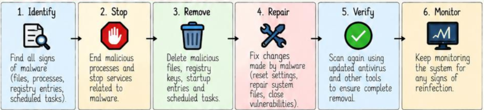
1. **Identificar (Identify):** Localizar todas as evidências e componentes da infecção (arquivos, processos ativos, chaves de registro, tarefas no agendador).

2. **Interromper (Stop):** Finalizar processos maliciosos em execução e desativar serviços do sistema vinculados ao artefato.

3. **Remover (Remove):** Excluir arquivos executáveis, chaves e valores inseridos no registro, atalhos na pasta de inicialização e tarefas agendadas.

4. **Reparar (Repair):** Restaurar o sistema ao estado operacional padrão (reverter alterações em configurações, restaurar arquivos corrompidos, corrigir vulnerabilidades exploradas).

5. **Verificar (Verify):** Realizar varreduras completas no sistema utilizando antivírus e utilitários forenses para validar a total ausência de resquícios.

6. **Monitorar (Monitor):** Manter monitoramento contínuo sobre o host durante os dias seguintes para garantir que não haja reincidência.

### Artefatos Comuns a Serem Removidos (Common Malware Artifacts to Remove)
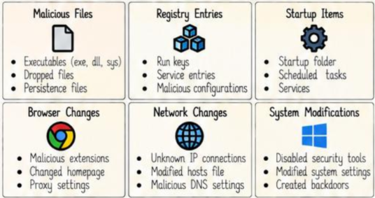
* **Arquivos Maliciosos:** Executáveis (`.exe`, `.dll`, `.sys`), arquivos descarregados (*dropped files*), arquivos vinculados à persistência.

* **Entradas no Registro:** Chaves `Run`, serviços maliciosos cadastrados e configurações fraudulentas.

* **Itens de Inicialização:** Atalhos na pasta Startup, tarefas agendadas no sistema e serviços de execução automática.

* **Alterações em Navegadores:** Extensões desconhecidas instaladas, redirecionamentos de página inicial e servidores proxy forçados.

* **Modificações de Sistema:** Softwares de segurança desativados, políticas locais alteradas e portas dos fundos (*backdoors*).

* **Alterações de Rede:** Conexões abertas com endereços IP desconhecidos, arquivos `hosts` modificados e servidores DNS fraudados.

### Ferramentas para Resposta a Incidentes e Remoção ( 

| Ferramenta   | Tipo   | Finalidade   |
| ----- | ----- | ----- |
| **Windows Defender** | Antivírus (*Antivirus*) | Varredura e remoção em tempo real |
| **Malwarebytes** | Antivírus   | Detecta e remove malware |
| **Kaspersky Virus Removal** | Antivírus   | Remoção de malware sob demanda |
| **Autoruns (Sysinternals)** | Sistema   | Visualizar e remover entradas de inicialização automática |
| **Process Explorer** | Sistema   | Inspecionar processos em execução |
| **Regedit / Regshot** | Registro   | Localizar e remover chaves maliciosas |
| **AdwCleaner** | Antimalware | Remover adwares e programas potencialmente indesejados (PUPs) |
| **GMER / RootkitRevealer** | Rootkit | Detectar malwares ocultos e rootkits |
| **Wireshark** | Rede   | Analisar tráfego de rede malicioso |
| **YARA** | Análise de Arquivos  | Correspondência de padrões para detecção de malware |
| **Volatility** | Perícia Forense em Memória   | Analisar despejos de memória (*memory dumps*) para identificar malware avançado |

### Exemplos do Mundo Real  

1. **WannaCry:** Ações imediatas de resposta envolveram isolamento da rede local para interromper propagação via SMB, desinfecção de sistemas e aplicação imediata da correção MS17-010.

2. **Emotet:** O processo de limpeza exigiu higienização profunda de entradas no Registro do Windows e eliminação de tarefas agendadas, seguido de monitoramento prolongado.

3. **TrickBot:** Demandou isolamento imediato da rede corporativa, expurgo dos binários descarregados e bloqueio dos domínios e IPs de C2 nos firewalls.

4. **Ransomware em Geral:** O ciclo de resposta engloba isolar os hosts comprometidos, erradicar binários, restaurar sistemas íntegros a partir de backups frios e mitigar o vetor de entrada.

5. **Sequestradores de Navegador (Browser Hijackers):** A remoção consiste em desinstalar extensões anômalas, restaurar atalhos e configurações originais dos navegadores e escanear com ferramentas antimalware.

### Melhores Práticas  

* Manter o sistema operacional e softwares atualizados com suas últimas correções de segurança.

* Operar ferramentas antivírus e antimalware com capacidade de inspeção em tempo real.

* Executar e testar rotinas regulares de backup offline.

* Auditar logs e tráfego de rede continuamente.

* Aplicar o princípio do menor privilégio para todas as contas de usuário e serviços.

* Estabelecer listas de permissão para execução de aplicações (*application whitelisting*).

* Treinar colaboradores contra ataques de engenharia social e e-mails de phishing.

* Ter um plano formal de resposta a incidentes amplamente documentado e testado.

* Conduzir auditorias e varreduras preventivas periódicas em todos os ativos computacionais.

## 20. Folha-Resumo de Malware 

### Folha-Resumo de Malware  

#### Definição e Conceitos Básicos

* **Malware:** Software malicioso desenvolvido especificamente para danificar, explorar ou obter acesso não autorizado a sistemas, redes e dados.

* **Propósito:** Roubar dados confidenciais, obter acessos não autorizados, paralisar operações ou assumir o controle total dos recursos.

* **Alvos:** Indivíduos, organizações corporativas e infraestruturas críticas.

* **Propagação:** Disseminado por meio de arquivos infectados, redes de dados, e-mails, downloads web ou mídias físicas removíveis.

* **Impactos:** Exfiltração de dados confidenciais, danos lógicos em sistemas, prejuízos financeiros diretos, paradas operacionais e perda de privacidade.

#### Tipos de Malware

* **Virus:** Anexa-se a um arquivo hospedeiro e se propaga mediante execução.

* **Worm:** Autorreplica-se de modo automatizado através de vulnerabilidades de rede.

* **Trojan:** Apresenta-se como um utilitário legítimo para ocultar funções maliciosas.

* **Ransomware:** Encripta dados essenciais e condiciona sua recuperação ao pagamento de resgate.

* **Spyware:** Monitora secretamente a máquina e subtrai informações privadas do usuário.

* **Adware:** Veicula anúncios intrusivos e rastreia padrões de consumo.

* **Rootkit:** Oculta atividades e comandos nos níveis mais privilegiados do sistema.

* **Keylogger:** Registra e armazena os toques efetuados no teclado físico ou virtual.

* **Botnet:** Agrega equipamentos infectados sob uma rede de controle centralizado.

* **Fileless Malware:** Opera exclusivamente no espaço de memória RAM sem persistir binários em disco.

#### Métodos de Entrega de Malware

* E-mails de Phishing (*Phishing Emails*)

* Anexos Maliciosos (*Malicious Attachments*)

* Downloads Automáticos (*Drive-by Downloads*)

* Sites Comprometidos (*Compromised Websites*)

* Publicidade Maliciosa (*Malicious Ads / Malvertising*)

* Mídias Físicas Removíveis (*Removable Media - USB*)

* Ataques de Cadeia de Suprimentos (*Supply Chain Attacks*)

* Exploração de Vulnerabilidades (*Exploiting Vulnerabilities*)

* Engenharia Social (*Social Engineering*)

#### Processo de Infecção por Malware

1. **Entrega (Delivery):** O arquivo ou payload alcança o sistema-alvo.

2. **Execução (Execution):** O código é colocado em execução no sistema.

3. **Instalação / Estabelecimento (Establishment):** Obtém acesso inicial e fixa-se no sistema.

4. **Persistência (Persistence):** Garante meios de reiniciar automaticamente com o sistema.

5. **Comando e Controle (Command and Control - C2):** Abre comunicação direta com a infraestrutura do atacante.

6. **Ações nos Objetivos (Actions on Objectives):** Conclui ações maliciosas como exfiltração de dados, destruição ou criptografia.

#### Cadeia de Ataque de Malware / Malware Kill Chain (Attack Chain)

1. **Reconhecimento (Recon):** Mapeamento e coleta de informações a respeito do alvo.

2. **Armamento (Weaponization):** Desenvolvimento do artefato associando exploit e código malicioso.

3. **Entrega (Delivery):** Envio da arma digital ao alvo.

4. **Exploração (Exploitation):** Acionamento da vulnerabilidade técnica ou do clique do usuário.

5. **Instalação (Installation):** Gravação de componentes e preparação do host invadido.

6. **Comando e Controle (C2):** Conexão com o servidor de controle remoto.

7. **Persistência (Persistence):** Estabelecimento de sobrevivência a reinicializações.

8. **Movimentação Lateral (Lateral Movement):** Salto do malware para outros dispositivos na rede.

9. **Ações nos Objetivos (Actions on Objectives):** Roubo de dados, encriptação com ransomware ou interrupção de serviços.

#### Extensões Comuns de Arquivos (Common File Extensions)

| **Categoria** | **Extensões** | 
| **Executáveis (Executables)** | `exe`, `dll`, `sys`, `bat`, `cmd` | 
| **Scripts** | `js`, `vbs`, `ps1`, `sh`, `py` | 
| **Documentos (Documents)** | `doc`, `docm`, `xls`, `xlsm`, `ppt` | 
| **Arquivos Compactados (Archives)** | `zip`, `rar`, `7z`, `iso` | 
| **Instaladores (Installers)** | `msi`, `apk`, `dmg` | 
| **Atalhos (Shortcuts)** | `lnk`, `url` | 
| **Outros (Others)** | `jar`, `scr`, `pif`, `com` | 

#### Técnicas de Persistência

* Chaves Run do Registro (*Registry Run Keys*)

* Pasta Startup (*Startup Folder*)

* Tarefas Agendadas (*Scheduled Tasks*)

* Serviços do Windows (*Services*)

* DLL Side-Loading / DLL Hijacking

* Modificação de MBR / Bootkit

* Inscrição em Eventos WMI (*WMI Event Subscription*)

* Extensões Maliciosas para Navegadores (*Browser Extensions*)

* Criação ou Adulteração de Arquivos de Sistema (*Create or Modify System Files*)

#### Técnicas de Evasão

* Ofuscação de Código (*Code Obfuscation*)

* Empacotamento e Criptografia (*Packing and Encryption*)

* Anti-Análise: Detecção de VM / Sandbox (*Anti-Analysis*)

* Polimorfismo (*Polymorphism*)

* Malware Sem Arquivos (*Fileless Malware*)

* Injeção de Processos (*Process Injection*)

* Uso de Utilitários Nativos (*Living off the Land / LOLBins*)

* Técnicas de Ocultação em Kernel (*Rootkit Techniques*)

* Desativação de Ferramentas de Segurança (*Disabling Security Tools*)

#### Termos Importantes (Important Terms)

* **IOC (Indicator of Compromise):** Indicador de Comprometimento (evidência forense de invasão).

* **C2 (Command and Control):** Servidor ou rede que comanda dispositivos invadidos.

* **Payload:** Carga útil maliciosa que executa as ações lesivas finais.

* **Exploit:** Código ou técnica que aproveita uma falha de segurança específica.

* **Zero-Day:** Falha de segurança desconhecida pelos desenvolvedores e sem patch oficial.

* **Sandbox:** Ambiente estritamente isolado para execução e análise de arquivos suspeitos.

* **Static Analysis (Análise Estática):** Avaliação de propriedades e código sem execução.

* **Dynamic Analysis (Análise Dinâmica):** Avaliação do comportamento durante a execução real.

* **Hash:** Identificador criptográfico exclusivo gerado matematicamente a partir de um arquivo.

* **Signature (Assinatura):** Padrão de bytes ou regras específicas usadas para identificar uma ameaça.

* **Polymorphic:** Código que altera sua representação superficial para burlar assinaturas.

* **Rootkit:** Mecanismo técnico dedicado a ocultar processos e arquivos com privilégios máximos.

* **Botnet:** Conjunto de múltiplos sistemas zumbis coordenados por um atacante.

* **Fileless Malware:** Malware operacional que roda em memória RAM sem arquivos em disco.

* **Persistence (Persistência):** Capacidade de manter o malware ativo após a reinicialização da máquina.

#### Ferramentas Comuns (Common Tools)

| Ferramenta  | Finalidade   |
| ----- | ----- |
| **VirusTotal** | Analisar arquivos e URLs |
| **Wireshark** | Análise de tráfego de rede |
| **Process Explorer** | Visualizar processos em execução |
| **Autoruns** | Análise de entradas de inicialização |
| **PEstudio** | Analisar a estrutura de arquivos PE |
| **Cuckoo Sandbox** | Análise dinâmica de malware |
| **ANY.RUN** | Sandbox interativa online |
| **IDA Pro** | Engenharia reversa |
| **Ghidra** | Desassemblagem e análise de código |
| **strings** | Extrair sequências de texto legíveis (*strings*) |
| **YARA** | Correspondência de padrões para detecção |
| **Volatility** | Perícia forense em memória (*memory forensics*) |

### 100 Perguntas de Entrevista por Categoria (100 Interview Questions)

#### 1. Conceitos Básicos (Basic Concepts: 1–10)

 1. O que é malware e como ele funciona? (*What is malware and how does it work?*)

 2. Quais são os diferentes tipos de malware? (*What are the different types of malware?*)

 3. Qual é a diferença entre um vírus e um worm? (*Difference between virus and worm?*)

 4. O que é um cavalo de Troia (Trojan horse)? (*What is a trojan horse?*)

 5. O que é ransomware? (*What is ransomware?*)

 6. O que é spyware? (*What is spyware?*)

 7. O que é um rootkit? (*What is a rootkit?*)

 8. O que é um keylogger? (*What is a keylogger?*)

 9. Como funciona uma botnet? (*How does a botnet work?*)

10. O que é malware sem arquivos (*fileless malware*)? (*What is fileless malware?*)

#### 2. Métodos de Entrega (Delivery Methods: 11–20)

11. Como o malware é entregue a um sistema? (*How is malware delivered to a system?*)

12. O que é um ataque de phishing? (*What is a phishing attack?*)

13. Como funcionam os anexos maliciosos? (*How do malicious attachments work?*)

14. O que é um *drive-by download*? (*What is drive-by download?*)

15. Como anúncios maliciosos (*malvertising*) disseminam malware? (*How do malicious ads spread malware?*)

16. O que é um ataque de cadeia de suprimentos (*supply chain attack*)? (*What is a supply chain attack?*)

17. Como um website comprometido entrega malware? (*How does a compromised website deliver malware?*)

18. O que é engenharia social? (*What is social engineering?*)

19. Como pendrives USB podem ser usados para propagar malware? (*How can USB drives be used to spread malware?*)

20. O que é um ataque do tipo *watering hole*? (*What is a watering hole attack?*)

#### 3. Processo de Infecção (Infection Process: 21–30)

21. Explique o processo de infecção por malware. (*Explain the malware infection process.*)

22. O que acontece durante a fase de execução? (*What happens during the execution phase?*)

23. O que é acesso inicial? (*What is initial access?*)

24. Como o malware estabelece persistência? (*How does malware establish persistence?*)

25. O que é comando e controle (C2)? (*What is command and control?*)

26. O que são cargas úteis (*payloads*) comuns? (*What are common payloads?*)

27. O que é movimentação lateral? (*What is lateral movement?*)

28. Como o malware se propaga em uma rede? (*How does malware spread in a network?*)

29. Quais são os objetivos comuns do malware? (*What are the objectives of malware?*)

30. Explique a cadeia de ataque (*malware kill chain*). (*Explain the malware kill chain.*)

#### 4. Persistência (Persistence: 31–40)

31. O que são chaves Run do Registro? (*What are registry run keys?*)

32. Como funciona a persistência pela pasta de inicialização (*startup folder*)? (*How does startup folder persistence work?*)

33. O que são tarefas agendadas e como são exploradas? (*What are scheduled tasks?*)

34. Como serviços do sistema podem ser usados para persistência? (*How can services be used for persistence?*)

35. O que é *DLL side-loading*? (*What is DLL side loading?*)

36. O que é um bootkit? (*What is a bootkit?*)

37. Como funciona a persistência via WMI? (*How does WMI persistence work?*)

38. Extensões de navegador podem ser usadas para persistência? (*Can browser extensions be used for persistence?*)

39. De que forma o malware pode modificar arquivos do sistema? (*How can malware modify system files?*)

40. Quais são as técnicas de persistência mais comuns? (*What are common persistence techniques?*)

#### 5. Técnicas de Evasão (Evasion Techniques: 41–50)

41. O que é ofuscação de código? (*What is code obfuscation?*)

42. O que são *packing* e criptografia de binários? (*What is packing and encryption?*)

43. O que é malware polimórfico? (*What is polymorphic malware?*)

44. Como o malware detecta máquinas virtuais? (*How does malware detect virtual machines?*)

45. O que é anti-debugging? (*What is anti debugging?*)

46. Como o malware opera em modo fileless na memória? (*What is fileless malware?*)

47. Como funciona a injeção de processos (*process injection*)? (*How does process injection work?*)

48. O que são LOLBins (*Living off the Land Binaries*)? (*What are LOLBins?*)

49. Como os rootkits evadem a detecção? (*How do rootkits evade detection?*)

50. De que forma o malware pode desativar ferramentas de segurança? (*How can malware disable security tools?*)

#### 6. Análise e Ferramentas (Analysis and Tools: 51–60)

51. O que é análise estática? (*What is static analysis?*)

52. O que é análise dinâmica? (*What is dynamic analysis?*)

53. O que é uma sandbox? (*What is a sandbox?*)

54. Como utilizar o VirusTotal na análise? (*How to use VirusTotal?*)

55. De que forma o Wireshark auxilia na análise de malware? (*How does Wireshark help in malware analysis?*)

56. O que é um arquivo PE (*Portable Executable*)? (*What is a PE file?*)

57. O que é e para que serve o PEStudio? (*What is PEStudio?*)

58. Como utilizar a ferramenta `strings`? (*How to use strings tool?*)

59. O que é o YARA e como funciona? (*What is YARA?*)

60. Como o Cuckoo Sandbox funciona? (*How does Cuckoo Sandbox work?*)

#### 7. Detecção e Prevenção (Detection and Prevention: 61–70)

61. O que é detecção baseada em assinatura? (*What is signature based detection?*)

62. O que é detecção baseada em heurística? (*What is heuristic based detection?*)

63. O que é detecção baseada em comportamento? (*What is behavior based detection?*)

64. O que é detecção baseada em anomalias? (*What is anomaly based detection?*)

65. O que é inteligência de ameaças (*threat intelligence*)? (*What is threat intelligence?*)

66. Como funciona um IDS (*Intrusion Detection System*)? (*How does an IDS work?*)

67. Como funciona um IPS (*Intrusion Prevention System*)? (*How does an IPS work?*)

68. Quais são as melhores práticas para prevenir infecções por malware? (*What are the best practices to prevent malware?*)

69. Como os firewalls auxiliam na prevenção? (*How can firewalls help in prevention?*)

70. Como funciona o controle por listas de permissão (*application whitelisting*)? (*How does application whitelisting work?*)

#### 8. Resposta a Incidentes e Remoção (Incident Response and Removal: 71–80)

71. O que é um plano de resposta a incidentes? (*What is an incident response plan?*)

72. Quais etapas estão envolvidas na remoção de malware? (*What steps are involved in malware removal?*)

73. Como identificar indicadores de comprometimento (IOCs)? (*How to identify indicators of compromise?*)

74. Como realizar a contenção de uma infecção por malware? (*How to contain a malware infection?*)

75. Como erradicar o malware de um ambiente? (*How to eradicate malware?*)

76. Qual é o papel da computação forense na análise de malware? (*What is the role of forensics in malware analysis?*)

77. Como restaurar sistemas de forma segura após uma infecção? (*How to restore systems after an infection?*)

78. Quais são os principais desafios na remoção de malware? (*What are the challenges in malware removal?*)

79. Como prevenir a reinfecção de sistemas? (*How to prevent reinfection?*)

80. O que são e qual a importância das lições aprendidas em um incidente? (*What are the lessons learned from an incident?*)

#### 9. Cenários do Mundo Real e Tópicos Avançados (Real World and Advanced: 81–90)

81. Explique um caso real de ataque por malware. (*Explain a real world malware attack.*)

82. O que é um exploit de dia zero (*zero-day exploit*)? (*What is a zero day exploit?*)

83. O que é uma APT (*Advanced Persistent Threat*)? (*What is an APT - Advanced Persistent Threat?*)

84. Como as botnets operam no mundo real? (*How do botnets operate in real world?*)

85. Como o ransomware se propaga dentro de redes corporativas? (*How does ransomware spread in organizations?*)

86. Dê um exemplo prático de um ataque sem arquivos (*fileless attack*). (*What is a fileless attack example?*)

87. Como um rootkit se oculta dentro do sistema operacional? (*How does a rootkit hide in the system?*)

88. Dê um exemplo de software trojanizado (*trojanized software*). (*What is a trojanized software example?*)

89. Quais são as tendências mais recentes do malware moderno? (*What are modern malware trends?*)

90. Como campanhas de malware utilizam servidores C2? (*How do malware campaigns use C2 servers?*)

#### 10. Perguntas Diversas (Miscellaneous: 91–100)

 91. O que é um IOC (*Indicator of Compromise*)? (*What is an IOC?*)

 92. Como o malware pode afetar ambientes em nuvem (*cloud environments*)? (*How can malware affect cloud environments?*)

 93. O que é análise de despejo de memória (*memory dump analysis*)? (*What is a memory dump analysis?*)

 94. Como o malware faz uso de criptografia? (*How does malware use encryption?*)

 95. Qual é o papel dos logs de auditoria na detecção de invasões? (*What is the role of logs in detection?*)

 96. De que maneira o aprendizado de máquina (*machine learning*) auxilia na detecção de ameaças? (*How does machine learning help in detection?*)

 97. Qual é a diferença prática entre um IDS e um IPS? (*What is the difference between IDS and IPS?*)

 98. Quais são os maiores desafios na detecção de malware polimórfico? (*What are the challenges in detecting polymorphic malware?*)

 99. Como implementar defesas efetivas contra malwares em cadeias de suprimentos (*supply chain*)? (*How to protect against supply chain malware?*)

100. Quais ferramentas e técnicas você utilizaria para analisar uma amostra desconhecida de malware? (*What tools and techniques would you use to analyze a new malware sample?*)

### Dicas Rápidas para Entrevistas (Quick Tips for Interviews)

* Compreenda com clareza e solidez os conceitos fundamentais de malware.

* Ilustre suas respostas utilizando exemplos concretos de ataques reais.

* Explique os processos e ciclos de vida etapa por etapa.

* Mencione ferramentas técnicas consagradas sempre que for pertinente.

* Aborde estratégias de mitigação e prevenção em conjunto com a análise técnica.

* Mantenha suas explicações concisas, lógicas e bem estruturadas.

* Destaque sempre as melhores práticas de segurança da informação.

* Mantenha-se constantemente atualizado sobre as tendências e ameaças mais recentes.


Abaixo apresenta-se o gabarito detalhado com as respostas técnicas para as 100 perguntas de entrevista presentes na página final do documento:

---

### 1. Conceitos Básicos (1-10)

1. **O que é malware e como funciona?**
*Malware* (*malicious software*) é qualquer programa concebido para prejudicar, explorar, comprometer ou obter acesso não autorizado a sistemas, redes ou dispositivos. Opera explorando vulnerabilidades de software ou manipulando utilizadores para se executar, realizar ações nocivas e comunicar externamente.
2. **Quais são os diferentes tipos de malware?**
Os tipos principais incluem vírus, *worms*, cavalos de Troia (*trojans*), *ransomware*, *spyware*, *keyloggers*, *adware*, *rootkits*, *bootkits* e *botnets*.
3. **Qual a diferença entre vírus e worm?**
Um vírus necessita de hospedar-se num ficheiro ou programa existente e requer intervenção humana para se espalhar. Um *worm* é autónomo, propaga-se diretamente através de redes e explora vulnerabilidades sem exigir interação do utilizador.
4. **O que é um cavalo de Troia (trojan horse)?**
É um programa que se disfarça de software legítimo e inofensivo para enganar o utilizador e fazê-lo executá-lo, abrindo portas de comunicação ou descarregando outras ameaças.
5. **O que é ransomware?**
Tipo de malware que cifra ficheiros ou bloqueia o acesso aos sistemas da vítima, exigindo o pagamento de um resgate para fornecer a chave de desencriptação.
6. **O que é spyware?**
Software malicioso concebido para monitorizar a atividade do utilizador e recolher informações confidenciais em segundo plano, sem autorização ou conhecimento do mesmo.
7. **O que é um rootkit?**
Conjunto de ferramentas que concede privilégios administrativos/Kernel a um atacante e oculta ativamente a sua presença, processos e ficheiros das defesas do sistema operativo.
8. **O que é um keylogger?**
Ferramenta (ou componente de malware) destinada a gravar e armazenar todas as teclas premidas pelo utilizador para capturar credenciais, conversas e dados bancários.
9. **Como funciona uma botnet?**
Consiste numa rede de dispositivos infetados (*bots* ou *zombies*) controlados centralmente ou via P2P por servidores de Comando e Controlo (C2), utilizados para ataques de DDoS, spam e propagação massiva.
10. **O que é malware sem ficheiros (fileless malware)?**
Malware que corre estritamente na memória volátil (RAM) e tira proveito de binários legítimos do próprio sistema (LOLBins), sem gravar ficheiros maliciosos tradicionais no disco rígido.

---

### 2. Métodos de Entrega (11-20)

11. **Como é que o malware é entregue a um sistema alvo?**
Através de e-mails de *phishing*, anexos infetados, *drive-by downloads*, dispositivos USB, exploração de vulnerabilidades remotas e ataques à cadeia de abastecimento.
12. **O que é um ataque de phishing?**
Técnica de engenharia social em que invasores enviam comunicações fraudulentas simulando identidades legítimas para induzir as vítimas a clicar em ligações maliciosas ou descarregar anexos.
13. **Como é que os anexos maliciosos funcionam?**
Contêm macros maliciosas (em documentos do Office), ficheiros executáveis compactados ou *scripts* que, ao serem abertos, executam código malicioso e descarregam o *payload*.
14. **O que é um drive-by download?**
Descarregamento e execução não intencional de malware que ocorre pelo simples facto de visitar um sítio web comprometido ou malicioso, explorando vulnerabilidades do navegador.
15. **Como é que os anúncios maliciosos (malvertising) propagam malware?**
Através da injeção de anúncios manipulados em redes de publicidade legítimas, redirecionando visitantes para *exploit kits* ou executando *scripts* vulneráveis.
16. **O que é um ataque à cadeia de abastecimento (supply chain attack)?**
Comprometimento de fornecedores, bibliotecas de código aberto ou atualizações legítimas de software de terceiros para atingir indiretamente clientes e redes finais.
17. **Como é que um sítio web comprometido entrega malware?**
Injetando código malicioso ou *iframes* ocultos nas páginas do servidor que redirecionam visitantes para servidores de exploração ou forçam descargas silenciosas.
18. **O que é engenharia social?**
Manipulação psicológica de pessoas para que executem ações voluntárias ou divulguem informações confidenciais que quebrem os procedimentos de segurança.
19. **Como podem ser utilizadas unidades USB para propagar malware?**
Explorando funcionalidades legadas como o *AutoRun*, atalhos `.lnk` maliciosos com nomes persuasivos ou emulando teclados (como dispositivos *BadUSB*).
20. **O que é um ataque watering hole?**
Técnica em que os atacantes identificam sítios web de nicho frequentemente acedidos por um grupo-alvo específico, comprometendo esses sítios para infetar os seus utilizadores regulares.

---

### 3. Processo de Infeção (21-30)

21. **Explique o processo de infeção por malware.**
Segurança em camadas: Entrega (*Delivery*) → Execução (*Execution*) → Estabelecimento/Infeção (*Establishment*) → Persistência (*Persistence*) → Comando e Controlo (*C2*) → Ações sobre os Objetivos (*Actions on Objectives*).
22. **O que acontece durante a fase de execução?**
O código malicioso é iniciado no processador e na memória do sistema, decifrando módulos, contornando defesas iniciais e preparando o ambiente.
23. **O que é o acesso inicial (initial access)?**
O vetor ou ponto de entrada através do qual o invasor consegue a primeira execução de código dentro da rede ou sistema da vítima.
24. **Como é que o malware estabelece persistência?**
Modificando configurações do sistema operativo, como chaves de registo, tarefas agendadas ou serviços, assegurando a sua reexecução automática a cada reinício.
25. **O que é comando e controlo (C2)?**
A infraestrutura de comunicação através da qual os atacantes transmitem ordens, descarregam ferramentas adicionais e recebem dados exfiltrados da máquina infetada.
26. **Quais são os payloads comuns de malware?**
*Ransomware* (módulos de encriptação), *infostealers* (roubo de credenciais), *keyloggers*, módulos de acesso remoto (RAT) e bots de DDoS.
27. **O que é movimento lateral?**
Técnicas que os invasores utilizam para estender o controlo a partir do primeiro sistema comprometido para outros nós e servidores dentro da mesma rede.
28. **Como é que o malware se propaga numa rede interna?**
Através da exploração de protocolos administrativos partilhados (SMB, RDP, WMI, SSH), reutilização de credenciais obtidas por despejo de memória e vulnerabilidades internas não corrigidas.
29. **Quais são os objetivos habituais do malware?**
Exfiltração de propriedade intelectual e dados confidenciais, extorsão financeira, espionagem industrial e disrupção das operações de negócio.
30. **Explique a Cyber Attack Chain (Cyber Kill Chain).**
Modelo estruturado em fases de uma intrusão: Reconhecimento → Armamento/Entrega → Exploração → Instalação → C2 → Movimento Lateral → Ações nos Objetivos.

---

### 4. Persistência (31-40)

31. **O que são as chaves Run do Registo do Windows?**
Entradas no Registo (tais como `HKLM\Software\Microsoft\Windows\CurrentVersion\Run` e `HKCU\...`) cujos executáveis apontados são iniciados automaticamente quando qualquer utilizador faz início de sessão.
32. **Como é que a pasta de arranque (Startup folder) funciona na persistência?**
Ficheiros ou atalhos colocados no diretório de arranque do Windows são carregados e executados automaticamente pelo explorador durante o arranque da sessão do utilizador.
33. **O que são tarefas agendadas (scheduled tasks)?**
Rotinas configuradas através do Gestor de Tarefas do Windows (`schtasks`) ou *cron jobs* no Linux para executar comandos maliciosos em horários específicos ou sob eventos do sistema.
34. **Como podem os serviços ser utilizados para persistência?**
Instalação ou sequestro de serviços de sistema (`sc.exe` ou `systemd`) que iniciam em segundo plano durante a fase de arranque do sistema operativo com privilégios elevados (`SYSTEM` ou `root`).
35. **O que é DLL Side-Loading?**
Técnica onde um executável legítimo é induzido a carregar uma biblioteca DLL maliciosa que partilha o mesmo nome de uma biblioteca esperada, posicionada estrategicamente no mesmo diretório.
36. **O que é um bootkit?**
Variante avançada de *rootkit* que infeta componentes de arranque primários, como o MBR (*Master Boot Record*) ou o VBR, executando código malicioso antes do próprio carregamento do sistema operativo.
37. **Como funciona a subscrição de eventos WMI (WMI event subscription)?**
Mecanismo que utiliza consumidores, filtros e associações de eventos WMI para acionar a execução de *scripts* maliciosos quando determinadas condições do sistema são atingidas.
38. **Podem as extensões de navegador ser utilizadas para persistência?**
Sim, extensões maliciosas carregam código a cada inicialização do navegador, mantendo capacidades de injeção de anúncios, roubo de sessões e tráfego sem alertas do sistema.
39. **Como pode o malware modificar ficheiros de sistema?**
Substituindo binários confiáveis, manipulando ficheiros de configuração (como o ficheiro `hosts`) ou através de *patching* de bibliotecas essenciais para desviar o fluxo de execução.
40. **Quais são as técnicas de persistência mais comuns?**
Chaves Run do Registo, Tarefas Agendadas, Serviços de Sistema, DLL Hijacking/Side-Loading e atalhos manipulados.

---

### 5. Evasão e Ofuscação (41-50)

41. **O que é ofuscação de código?**
Prática de transformar o código fonte ou binário de forma a torná-lo quase ilegível para analistas e motores antivírus baseados em assinaturas, sem alterar a sua lógica funcional.
42. **O que é compactação (packing) e encriptação de binários?**
O *packing* comprime o binário executável original, armazenando-o encriptado juntamente com uma rotina de descompactação (*stub*) responsável por descompactá-lo diretamente na memória durante a execução.
43. **O que é malware polimórfico?**
Malware que altera a sua aparência e assinatura binária a cada infeção (utilizando rotinas de encriptação variáveis), embora mantenha a rotina interna subjacente idêntica.
44. **Como é que o malware deteta máquinas virtuais (VMs)?**
Procurando artefactos de hipervisores como nomes de controladores, processos característicos de ferramentas convidadas (ex.: *VBoxService*, *VMware Tools*), instruções de CPU específicas e endereços MAC virtuais.
45. **O que é anti-debugging?**
Técnicas implementadas para impedir ou dificultar a análise interativa por depuradores, como recorrer à API `IsDebuggerPresent`, manipular exceções ou detetar pontos de interrupção (*breakpoints*).
46. **O que é injeção de processos (process injection)?**
Método de execução de código malicioso no espaço de endereçamento de um processo legítimo em execução (como `explorer.exe` ou `svchost.exe`) para mascarar a sua presença e contornar controlos.
47. **O que são LOLBins (Living off the Land Binaries)?**
Binários legítimos e assinados do sistema operativo (ex.: `certutil`, `powershell`, `mshta`) que são instrumentalizados por atacantes para executar código nocivo sem levantar alarmes.
48. **Como é que os rootkits evitam a deteção?**
Interceptando chamadas de sistema no Kernel (*system call hooking*), manipulando estruturas de dados do núcleo (DKOM) para esconder processos, portas de rede e chaves de registo.
49. **Como é que o malware desativa ferramentas de segurança?**
Terminando processos antivírus/EDR, revogando permissões de ficheiros de segurança, bloqueando ligações a servidores de assinaturas ou recorrendo a controladores vulneráveis (*BYOVD*) para finalizar proteções ao nível do Kernel.
50. **Qual a diferença entre evasão e ofuscação?**
Ofuscação é a técnica de mascarar o código e as cadeias de texto. Evasão é o conceito abrangente de iludir ativamente a deteção em tempo real e neutralizar os mecanismos de segurança do ambiente.

---

### 6. Análise e Ferramentas (51-60)

51. **O que é análise estática?**
Exame das características do ficheiro binário sem o executar, incluindo leitura de cabeçalhos, extração de cadeias de caracteres, cálculo de *hashes* e engenharia reversa do código.
52. **O que é análise dinâmica?**
Observação e monitorização do comportamento do malware em tempo real enquanto este é executado num ambiente isolado e controlado.
53. **O que é uma sandbox?**
Ambiente virtual hermeticamente isolado concebido para executar e registar em segurança ficheiros suspeitos sem colocar em risco a infraestrutura de produção.
54. **Como se utiliza o VirusTotal?**
Submetendo ficheiros, URLs ou *hashes* criptográficos para agregação de resultados e consulta contra dezenas de motores antivírus comerciais e bases de dados de inteligência de ameaças.
55. **Como é que o Wireshark auxilia na análise de malware?**
Captura e disseca o tráfego de rede gerado pelo malware, permitindo inspecionar comunicações DNS, tráfego HTTP/HTTPS não cifrado, conexões C2 e dados a ser exfiltrados.
56. **O que é um ficheiro PE?**
*Portable Executable* (PE) é o formato padrão de ficheiros binários executáveis, DLLs e controladores em sistemas operativos Microsoft Windows.
57. **O que é o PEStudio?**
Ferramenta de triagem de análise estática para o formato PE que destaca indicadores suspeitos, funções de importação críticas, entropia de secções e recursos anómalos.
58. **Como se utiliza a ferramenta `strings`?**
Extrai sequências de caracteres imprimíveis contidas no ficheiro, revelando potenciais endereços IP, domínios, comandos de shell, mensagens de erro e caminhos de ficheiros.
59. **O que é o YARA?**
Linguagem baseada em regras com correspondência textual e binária, amplamente utilizada para identificar, classificar e caçar amostras de malware com base em padrões definidos.
60. **Como funciona o Cuckoo Sandbox?**
Sistema automatizado de código aberto que executa amostras numa VM convidada enquanto agentes monitorizam e geram relatórios detalhados sobre alterações no registo, chamadas de API, ficheiros criados e tráfego de rede.

---

### 7. Deteção e Prevenção (61-70)

61. **O que é deteção baseada em assinaturas?**
Abordagem que procura sequências binárias estáticas ou *hashes* criptográficos conhecidos e previamente catalogados numa base de dados.
62. **O que é deteção heurística?**
Técnica que analisa padrões de instruções ou características estruturais do código para identificar ameaças desconhecidas que exibam semelhanças com famílias de malware conhecidas.
63. **O que é deteção baseada em comportamento?**
Monitorização das ações executadas em tempo de execução (ex.: tentativas de injeção em memória, modificações de chaves críticas) para bloquear atividades inerentemente nocivas, independentemente da assinatura do ficheiro.
64. **O que é deteção baseada em anomalias?**
Construção de uma linha de base (*baseline*) do comportamento considerado normal num sistema ou rede, gerando alertas sempre que ocorre um desvio estatístico desse padrão.
65. **O que é Threat Intelligence (Inteligência de Ameaças)?**
Informações recolhidas e tratadas sobre vetores de ataque, motivações, infraestruturas e indicadores de agentes maliciosos que apoiam a tomada de decisões e enriquecem controlos defensivos.
66. **Como funciona um IDS (Intrusion Detection System)?**
Monitoriza o tráfego de rede ou registos locais em modo passivo, inspecionando pacotes e alertando os analistas quando deteta padrões suspeitos.
67. **Qual a diferença entre IDS e IPS?**
O IDS apenas deteta e emite alertas sobre incidentes; o IPS (*Intrusion Prevention System*) atua ativamente no fluxo de tráfego (*in-line*), bloqueando e descartando pacotes maliciosos de imediato.
68. **Quais são as melhores práticas para prevenir malware?**
Manter sistemas e aplicações atualizados (*patching*), aplicar o princípio do menor privilégio, utilizar autenticação multifator (MFA), implementar soluções de EDR e promover a consciencialização contra engenharia social.
69. **Como podem as firewalls ajudar na prevenção de malware?**
Filtrando tráfego não autorizado, bloqueando portas críticas e impedindo que máquinas internas estabeleçam ligações a endereços IP ou domínios C2 catalogados como maliciosos.
70. **Como funciona a aplicação de whitelisting de aplicações (Application Whitelisting)?**
Política de segurança estrita em que apenas executáveis e *scripts* explicitamente autorizados e certificados recebem permissão para execução, bloqueando todos os outros por predefinição.

---

### 8. Resposta a Incidentes e Remoção (71-80)

71. **O que é um Plano de Resposta a Incidentes?**
Conjunto documentado e estruturado de procedimentos que orienta as equipas de segurança a identificar, conter, erradicar e recuperar de ataques informáticos de forma rápida e controlada.
72. **Quais são os passos envolvidos na remoção de malware?**
Isolar o sistema afetado da rede, identificar e terminar processos nocivos, eliminar ficheiros maliciosos, limpar chaves de persistência no registo e verificar a integridade geral do sistema.
73. **Como identificar Indicadores de Comprometimento (IoCs)?**
Correlacionando eventos em ferramentas SIEM/EDR, inspecionando registos de autenticação, analisando ligações de rede anómalas e verificando *hashes* de ficheiros desconhecidos.
74. **Como conter uma infeção de malware?**
Isolando as máquinas comprometidas ao nível de VLAN ou desconectando-as da rede física/Wi-Fi, e bloqueando IoCs na firewall de perímetro para evitar a disseminação lateral.
75. **Como erradicar malware?**
Removendo todos os vestígios da ameaça (ficheiros, contas adulteradas e tarefas agendadas) ou restaurando os sistemas a partir de imagens limpas e comprovadamente fidedignas.
76. **Qual o papel da análise forense na análise de malware?**
Recolher e preservar evidências digitais (como imagens de disco e despejos de memória volátil) para reconstruir a cronologia da intrusão, determinar o alcance e suportar potenciais ações legais.
77. **Como restaurar sistemas após uma infeção?**
Reconstruindo os sistemas afetados a partir de imagens de confiança, redefinindo credenciais e restaurando cópias de segurança isoladas, mantendo monitorização intensiva no pós-restauro.
78. **Quais são os principais desafios na remoção de malware?**
Lidar com malware sem ficheiros em memória, infeções ao nível do Kernel (*rootkits*), mecanismos duplos de persistência cruzada e risco de reinfeção através da rede.
79. **Como prevenir a reinfeção?**
Corrigindo a vulnerabilidade raiz que permitiu a intrusão inicial, atualizando regras de deteção, reforçando credenciais de acesso e revogando acessos partilhados suspeitos.
80. **O que são as "lições aprendidas" num incidente?**
Fase retrospetiva onde a equipa revê o que ocorreu, avalia a eficácia da contenção, documenta lacunas processuais e implementa melhorias nas defesas e políticas.

---

### 9. Mundo Real e Avançado (81-90)

81. **Explique um ataque de malware no mundo real.**
Exemplo: O ataque do *WannaCry* em 2017, que utilizou o *exploit* EternalBlue (SMBv1) para infetar e cifrar centenas de milhares de computadores globalmente num espaço de poucas horas, impactando hospitais e redes de transportes.
82. **O que é um exploit de dia zero (Zero-Day)?**
Um ataque ou exploração de uma vulnerabilidade de software que ainda é desconhecida do fabricante ou para a qual ainda não existe correção pública disponível.
83. **O que é uma APT (Ameaça Persistente Avançada)?**
Grupo de atacantes altamente capacitado e financiado (geralmente ligado a estados-nação) que conduz campanhas prolongadas e furtivas para aceder a alvos de elevado valor.
84. **Como operam as botnets no mundo real?**
São organizadas em esquemas de monetização no cibercrime, oferecidas frequentemente sob modelos de "Crime-as-a-Service" para lançar ataques massivos de negação de serviço distribuído (DDoS) ou distribuir vagas massivas de *spam*.
85. **Como é que o ransomware se propaga em organizações?**
Normalmente ganha acesso através de credenciais de VPN/RDP comprometidas ou *phishing*, seguido de enumeração interna (Active Directory), movimento lateral com ferramentas administrativas e cifragem massiva de servidores centrais.
86. **O que é um exemplo de ataque sem ficheiros?**
Injeção de comandos PowerShell codificados diretamente a partir de tarefas WMI, que descarrega código para a memória RAM e executa ferramentas LOLBins sem gravar artefactos binários no disco.
87. **Como é que um rootkit se oculta no sistema?**
Altera ponteiros da tabela de chamadas de sistema (SSDT) ou manipula listas duplamente ligadas no Kernel do Windows, omitindo os seus nós da enumeração das ferramentas convencionais de administração.
88. **O que é software de extorsão (rogueware/scareware)?**
Software fraudulento que emite falsos avisos de segurança ou bloqueia funcionalidades básicas, coagindo a vítima a pagar por uma licença inútil para "limpar" o sistema.
89. **Quais são as tendências modernas de malware?**
Operações de Ransomware de dupla/tripla extorsão, ataques direcionados à cadeia de abastecimento, malware concebido especificamente para ambientes de nuvem/contentores e ataques a controladores legítimos (*BYOVD*).
90. **Como utilizam as botnets servidores C2?**
Recorrem a arquiteturas flexíveis com recurso a algoritmos de geração de domínio (DGA), *Fast Flux DNS*, redes Tor e protocolos legítimos cifrados (HTTPS) para tornar a comunicação resiliente a bloqueios.

---

### 10. Diversos (91-100)

91. **O que é um IoC (Indicador de Comprometimento)?**
Evidência digital observável que indica com elevado grau de certeza que um sistema ou rede foi invadido (ex.: *hashes* de ficheiros, endereços IP suspeitos, chaves de registo alteradas).
92. **Como pode o malware afetar ambientes de computação na nuvem?**
Explorando permissões excessivas de gestão de identidade (IAM), comprometendo chaves de acesso a APIs, sequestrando recursos computacionais para mineração de criptomoedas (*cryptojacking*) e infetando imagens de contentores.
93. **O que é uma análise de despejo de memória (memory dump analysis)?**
Inspeção forense da memória volátil (RAM) com recurso a ferramentas como o *Volatility* para identificar processos ocultos, conexões de rede ativas e chaves de desencriptação residentes em memória.
94. **Como recorre o malware à encriptação?**
Tanto para cifrar os ficheiros das vítimas em ataques de *ransomware* como para ofuscar o seu próprio código executável e proteger os canais de comunicação com o servidor C2 contra inspeção de pacotes.
95. **O que é o papel da lógica de deteção nos logs?**
Identificar anomalias comportamentais e padrões de ataque através da correlação sistemática de registos de autenticação, comandos de terminal e fluxos de rede integrados num SIEM.
96. **Como auxilia o Machine Learning na deteção de malware?**
Identificando padrões e relações não lineares em grandes volumes de atributos de ficheiros e tráfego, detetando variantes desconhecidas sem depender estritamente de assinaturas estáticas.
97. **O que é criptoanálise no contexto de ransomware?**
Exame dos esquemas criptográficos e falhas na geração de números pseudoaleatórios (PRNG) ou implementação de chaves no malware para tentar recuperar os ficheiros sem pagar o resgate.
98. **Quais os desafios na deteção de malware polimórfico?**
Como a assinatura binária e a estrutura externa mudam constantemente a cada nova compilação/infeção, as regras baseadas em *hashes* e assinaturas estáticas tornam-se ineficazes.
99. **Como proteger redes contra ataques à cadeia de abastecimento?**
Implementando verificação rigorosa de integridade e assinaturas digitais de software, auditorias contínuas de dependências de terceiros e segmentação estrita dos acessos concedidos a fornecedores.
100. **Que ferramentas e técnicas utilizaria para analisar uma nova amostra de malware?**
Iniciaria com **análise estática básica** (cálculo de *hash*, extração de *strings*, verificação de cabeçalhos no PEStudio/CFF Explorer), passaria para **análise dinâmica** numa *sandbox* isolada (monitorizando com Process Monitor, Wireshark e Regshot) e, se necessário, avançaria para **análise estática e dinâmica avançada** com desmontadores/depuradores (Ghidra, IDA Pro ou x64dbg).


---

## 👤 GitHub

[](https://github.com/floresjcd) 
**[@floresjcd](https://github.com/floresjcd)**
